# Game Compatibility

## How to read this page

The local validation corpus contains 245 distinct CBE files in three groups:
A (123), B (74), and C (48). Group identifiers distinguish archive variants,
including applications with the same name, and table filenames use
group-relative paths such as `A/`, `B/`, and `C/`. Byte-identical archives
are kept once, with group priority B, then C, then A. Game files are supplied
separately and are not included in this repository.

Each file runs a 200-frame idle capture with up to 100,000,000 instructions
per frame and a 90-second wall-clock guard; all 245 files complete without
execution failures or timeouts. This execution result is not a gameplay
rating: a screenshot may show a loading screen, and correct display
dimensions alone do not establish correct rendering. For investigation
details and fix history, follow the linked issues.

Status levels used in the tables:

| Status | Meaning |
| --- | --- |
| Playable | Core gameplay entered and operated in scripted runs (not necessarily completed) |
| Partial | Interactive screens verified; gameplay unverified or only partly verified |
| Boots only | Renders its startup screens; interaction not verified |
| Blocked (online) | The only entry path is the retired Coolbar platform service |
| Bad game file | The defect is in the game data itself; not repairable on the emulator side |
| Fails to start | Guest execution stops during startup |

In the Network column, “Required” denotes an established network dependency,
“Not assessed” means the dependency has not been verified for that variant,
and “Blocked: dead server” marks a retired Coolbar service as the only entry
path. All network and billing callbacks are local offline simulations; they
never provide the original server's content or a real carrier payment.

## Overview

| Group | Files | Execution completed | Execution failed | Timed out |
| --- | ---: | ---: | ---: | ---: |
| A | 123 | 123 | 0 | 0 |
| B | 74 | 74 | 0 | 0 |
| C | 48 | 48 | 0 | 0 |

Across the corpus, 56 titles are verified playable and 48 more are verified
interactive at menu/UI level; 106 render their startup screens with
interaction not yet verified. 21 online titles are blocked because their only
entry path is a retired Coolbar service, 11 fail during startup, and 3 carry
defects in the game data itself that cannot be repaired on the emulator side
(坦克大战V10, issue #103; dragon, issue #197; Rich, issue #201). Complete
playthroughs and the full set of audio paths remain unverified.

## Application List

Screenshots use separate A/B/C image directories to avoid filename
collisions. The Display column records the active output dimensions after
orientation.

### Group A

| # | Application / file | Display | Screenshot | Network | Status | Notes |
| ---: | --- | --- | --- | --- | --- | --- |
| 1 | `A/1943命运之决战V101.CBE` | 240×320 | 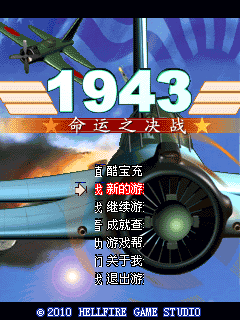 | Local billing simulation | Playable | Local point-play receipt leads to aircraft/equipment selection and battle; movement, firing and retry verified. Acknowledge the receipt with the right soft key (`E`); `Q` opens equipment and confirms the sortie. Full campaign and audio unverified |
| 2 | `A/三国大富翁(新品).CBE` | 240×320 |  | Not assessed | Partial | Title, help, character select, store and the fee dialog work; the board area behind in-game menus renders dark |
| 3 | `A/三国大富翁V10.CBE` | 240×320 | 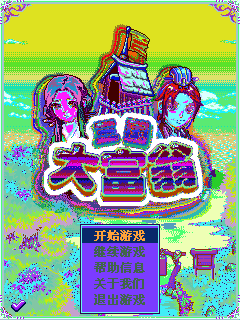 | Not assessed | Partial | In-game menus, store and system menus work over a rendered location scene; the loading screen needs repeated Confirm presses to advance (the game's own behavior) |
| 4 | `A/三国志(新品)V10.CBE` | 240×320 | 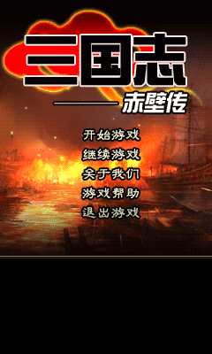 | Not assessed | Partial | Local SMS billing reaches the story dialogue; map loading then faults, so gameplay is unreachable |
| 5 | `A/三国志@火.CBE` | 240×320 |  | Not assessed | Fails to start | Only the loading message renders; startup does not complete |
| 6 | `A/三国志V101.CBE` | 240×320 | 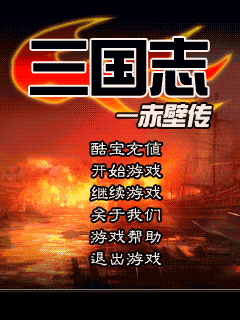 | Local receipt | Playable | The receipt path reaches the palace battle map; the unit command menu, movement highlight and attack-range preview verified. Later battles, touch input and audio unverified (issue #86) |
| 7 | `A/俄罗斯方块(免费).CBE` | 240×320 | 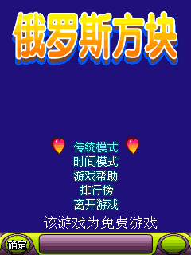 | Not assessed | Partial | Title/menu rendering and basic selection checked; complete gameplay unverified |
| 8 | `A/傲气雄鹰V101.CBE` | 240×320 | 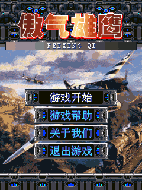 | Offline menu; paid play unavailable | Partial | The title menu renders with selection arrows; local SMS billing reaches the flight introduction; starting play faults during map loading (issue #114) |
| 9 | `A/僵尸先生(强推).CBE` | 320×240 | 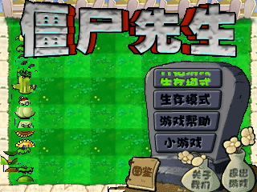 | No known requirement | Playable | Seed selection, the 5×9 lawn, plant placement with sun cost, zombies advancing and the loss/return-to-title flow verified (issues #88, #89). Full campaign and audio unverified |
| 10 | `A/僵尸先生(新品)V10.CBE` | 320×240 | 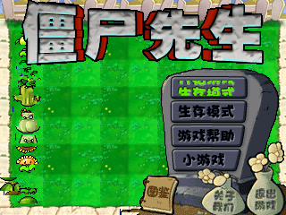 | Not assessed | Playable | Story page, seed chooser, plant placements with sun cost, advancing zombies and the loss/return-to-title flow verified (issue #89). Full campaign and audio unverified |
| 11 | `A/僵尸先生V101.CBE` | 320×240 | 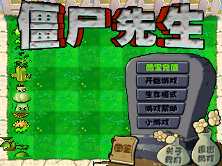 | Blocked: dead server | Blocked (online) | Online title: the guest requires the retired Coolbar platform service; the offline error page is the expected result (issue #90) |
| 12 | `A/动感保龄球.CBE` | 240×320 | 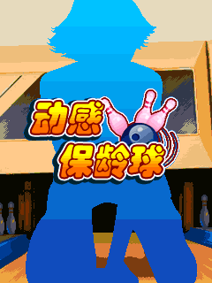 | Not assessed | Partial | Title/menu rendering and basic selection checked; complete gameplay unverified |
| 13 | `A/卧底风云(精品).CBE` | 240×320 |  | Not assessed | Playable | A confirm-key run reaches the street scene and returns cleanly; later stages unverified |
| 14 | `A/卧底风云V10.CBE` | 240×320 | 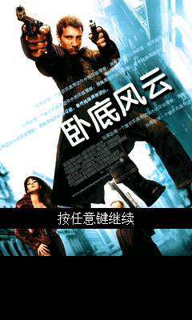 | Not assessed | Playable | A confirm-key run reaches the street scene and returns cleanly; later stages unverified |
| 15 | `A/卧底风云V101.CBE` | 240×320 | 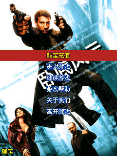 | Blocked: dead server | Blocked (online) | Online title: the guest requires the retired Coolbar platform service; the offline error page is the expected result (issue #93) |
| 16 | `A/原罪天使V101.CBE` | 240×320 | 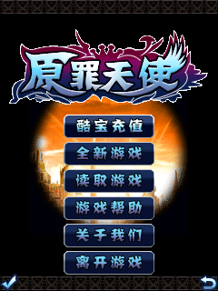 | Blocked: dead server | Blocked (online) | The animated title menu renders; 新的游戏 requires the retired Coolbar service (issue #94) |
| 17 | `A/双截龙(新品).CBE` | 240×320 | 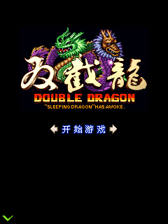 | Not assessed | Playable | Level 1-1 renders the player, enemies and HUD; movement and attack input work, and the in-game menu returns to the title (issue #95). Later stages and audio unverified |
| 18 | `A/双截龙V10.CBE` | 240×320 | 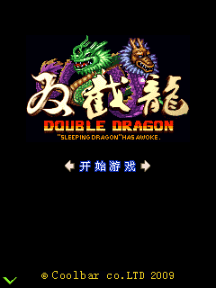 | Not assessed | Playable | The 1-1 world, HUD and characters render; movement and attack work, and the soft-key menu returns to the title (issue #96). Later stages unverified |
| 19 | `A/变形金刚(新品).CBE` | 240×320 | 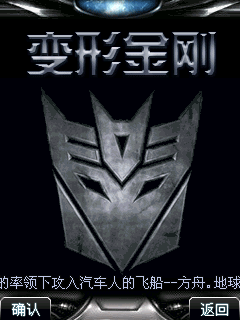 | Not assessed | Partial | Tutorial dialog and the road/pipe puzzle grid render; the piece selector responds to input |
| 20 | `A/合金装备(新品).CBE` | 240×320 | 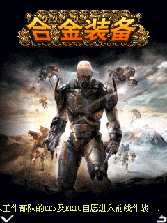 | Not assessed | Boots only | Title content renders; continuation input and gameplay unverified |
| 21 | `A/合金装备V10.CBE` | 240×320 | 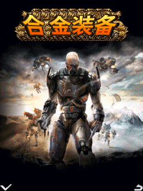 | Not assessed | Partial | Local SMS billing reaches terrain/HUD/tutorial; a later controller call faults, so gameplay is unavailable |
| 22 | `A/合金装备V101.CBE` | 240×320 | 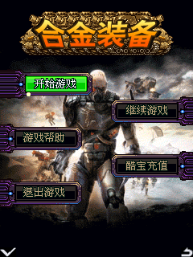 | Not assessed | Boots only | Offline continuation frame captured; interaction/gameplay unverified |
| 23 | `A/喜羊羊与灰太狼@新.CBE` | 240×320 |  | Not assessed | Playable | Touch shooting and special items raise the score and eliminate wolves; the death/retry prompt appears and Back returns to level selection. Full campaign and audio unverified |
| 24 | `A/喜羊羊与灰太狼V10.CBE` | 240×320 |  | Not assessed | Playable | Local SMS billing enters shooting play; shots and special items score and eliminate a wolf; the life-purchase prompt and Back to level selection respond. Full campaign and audio unverified |
| 25 | `A/噗噜噗噜旋转棒V101.CBE` | 240×320 |  | Blocked: dead server | Blocked (online) | The title mascot renders; the guest still requires the retired Coolbar service (issue #101) |
| 26 | `A/在线书城(新品).CBE` | 240×320 |  | Required for online content | Partial | Title, toolbar and directional selection verified; online content and request completion unverified |
| 27 | `A/在线书城V10.CBE` | 240×320 |  | Not assessed | Boots only | The idle capture shows the main bookshelf page; font/layout differences remain; interaction unverified |
| 28 | `A/坦克大战(新品).CBE` | 240×320 | 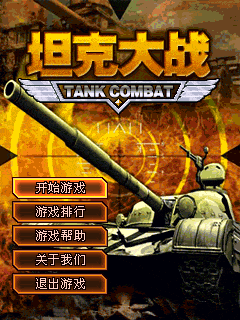 | Not assessed | Playable | A confirm-key run completes the first scene and returns cleanly; controls and later stages unverified |
| 29 | `A/坦克大战V10.CBE` | 240×320 |  | Not assessed | Bad game file | The defect is in the game data itself — the play run cannot be repaired on the emulator side (issue #103) |
| 30 | `A/坦克大战V101.CBE` | 240×320 |  | Blocked: dead server | Blocked (online) | Online title: the guest requires the retired Coolbar platform service; the offline error page is the expected result (issue #104) |
| 31 | `A/士兵突袭(精品).CBE` | 240×320 | 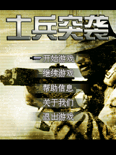 | Not assessed | Partial | Title/menu rendering and basic selection checked; complete gameplay unverified |
| 32 | `A/士兵突袭V10.CBE` | 240×320 |  | Not assessed | Playable | Boots through the title, shop interface and payment confirmation screens; stage progression beyond that unverified (issue #106) |
| 33 | `A/大唐双龙(新品)V101.CBE` | 240×320 |  | Blocked: dead server | Blocked (online) | Online title: the guest requires the retired Coolbar platform service; the offline error page is the expected result (issue #107) |
| 34 | `A/大话西游(新品).CBE` | 240×400 | 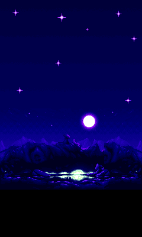 | Not assessed | Partial | Menu, help and exit work; choosing 进入游戏 ends the guest through its own exit path — its loader requires a platform licence record that cannot be satisfied offline (issue #108, open) |
| 35 | `A/大话西游V10.CBE` | 240×320 |  | Not assessed | Partial | Confirm advances past the story to a level HUD, but the play area shows only a starfield and the dialog is empty; the pause menu responds, and the reachable world map never animates (issue #109, open) |
| 36 | `A/太空堡垒(新品).CBE` | 240×320 | 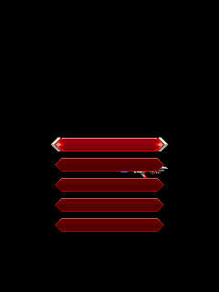 | Not assessed | Playable | A confirm-key run finishes cleanly and returns; later stages unverified |
| 37 | `A/太空堡垒V10.CBE` | 240×320 | 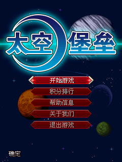 | Not assessed | Playable | A confirm-key run finishes cleanly and returns; later stages unverified |
| 38 | `A/封神演义(新品).CBE` | 240×320 | 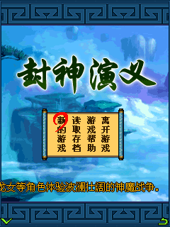 | Not assessed | Playable | A confirm-key run finishes cleanly and returns; later stages unverified |
| 39 | `A/封神演义V10.CBE` | 240×320 | 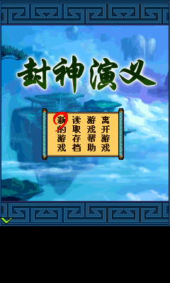 | Not assessed | Playable | A confirm-key run finishes cleanly and returns; later stages unverified |
| 40 | `A/封神演义V101.CBE` | 240×320 | 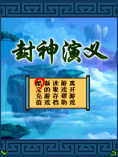 | Blocked: dead server | Blocked (online) | The interactive title menu responds to keys and taps; 新的游戏 requires the retired Coolbar service (issue #114) |
| 41 | `A/小酷V10.CBE` | 240×320 |  | Not assessed | Boots only | Idle frame captured; interaction/gameplay unverified |
| 42 | `A/小酷V101.CBE` | 240×320 |  | Required | Partial | Offline startup advances past the update prompt; waiting screen, timeout popup and dismissal checked; subsequent Back can fault, and usable online content is missing |
| 43 | `A/小酷书城(免费看书)V101.CBE` | 240×320 |  | Not assessed | Boots only | Offline continuation frame captured; interaction/gameplay unverified |
| 44 | `A/小酷农场(火爆上线)V10.CBE` | 240×320 | 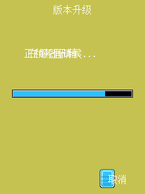 | Not assessed | Fails to start | Start shows a version-upgrade/network-failure page with only 确定; no input combination reaches the farm (issue #115) |
| 45 | `A/小酷音乐(强推)V101.CBE` | 240×320 |  | Not assessed | Fails to start | The guest stops after the offline continuation step; usable startup and online content unverified |
| 46 | `A/开心花园(新品).CBE` | 240×320 |  | Not assessed | Partial | Seeding, the diary and field entry respond to input, but no player character or action is recognisable (issue #116) |
| 47 | `A/恋爱助手V10.CBE` | 240×320 |  | Not assessed | Partial | List menu, submenu, article selection, scrolling and back navigation verified; billing callbacks are simulated offline |
| 48 | `A/恶魔城(新品).CBE` | 240×320 | 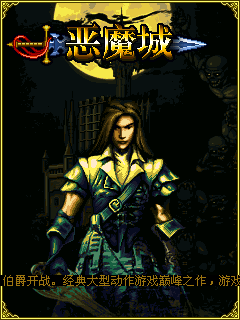 | Not assessed | Playable | A confirm-key run reaches the first stage and returns cleanly; complete gameplay unverified |
| 49 | `A/恶魔城V10.CBE` | 240×320 | 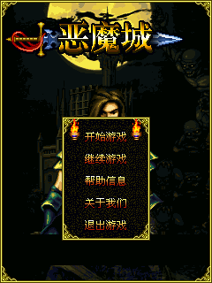 | Not assessed | Playable | A confirm-key run reaches the first stage and returns cleanly; complete gameplay unverified |
| 50 | `A/战争机器V101.CBE` | 240×320 | 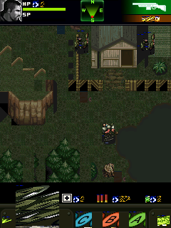 | Local billing simulation; directional movement verified | Playable | The point-play receipt leads into the first stage: the intro dialogue advances with Confirm and a direction hold moves the player off the helipad. The separate 数据更新 entry still needs the retired platform server; later stages and audio unverified (issue #119) |
| 51 | `A/战火军旗V10.CBE` | 240×320 | 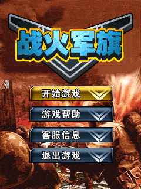 | Not assessed | Boots only | Idle frame captured; interaction/gameplay unverified |
| 52 | `A/战火军棋(新品).CBE` | 240×320 | 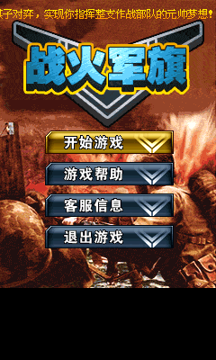 | Not assessed | Partial | Title, menu, help, purchase panel and keypad/touch checked; paid battles unverified |
| 53 | `A/拆弹专家V101.CBE` | 240×320 | 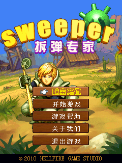 | Blocked: dead server | Blocked (online) | Online title: the guest requires the retired Coolbar platform service; the offline error page is the expected result (issue #120) |
| 54 | `A/掌上书城V10.CBE` | 240×320 |  | Not assessed | Boots only | Idle frame captured; interaction/gameplay unverified |
| 55 | `A/掌上地图V10.CBE` | 240×320 |  | Not assessed | Boots only | Offline continuation frame captured; interaction/gameplay unverified |
| 56 | `A/星际宝藏(新品).CBE` | 240×320 |  | Not assessed | Playable | LEVEL1 renders the gem board; cursor selection, movement and one completed swap/match with a score update verified (issue #121) |
| 57 | `A/星际宝藏V10.CBE` | 240×320 | 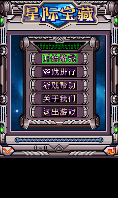 | Not assessed | Boots only | Idle frame captured; interaction/gameplay unverified (issue #122) |
| 58 | `A/暴力摩托(新品).CBE` | 240×320 | 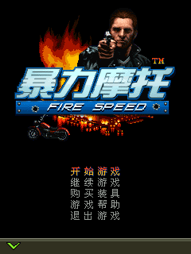 | Not assessed | Boots only | The scene renders and the run exits cleanly; controls unverified |
| 59 | `A/暴力摩托V10.CBE` | 240×320 | 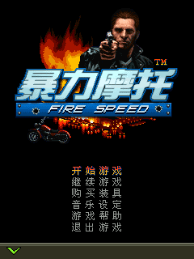 | Not assessed | Boots only | The scene renders and the run exits cleanly; controls unverified |
| 60 | `A/极品飞车(火爆).CBE` | 240×320 | 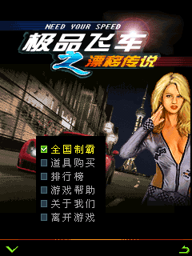 | Not assessed | Partial | Startup, menu navigation, help, back and touch input verified; starting a race hits a guest picture-library assertion |
| 61 | `A/极品飞车V10.CBE` | 240×320 | 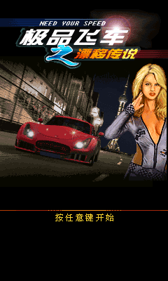 | Not assessed | Boots only | Idle frame captured; interaction/gameplay unverified |
| 62 | `A/极限挑战V101.CBE` | 240×320 | 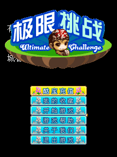 | Blocked: dead server | Blocked (online) | Online title: the guest requires the retired Coolbar platform service; the offline error page is the expected result (issue #125) |
| 63 | `A/毒蛇行动V101.CBE` | 240×320 | 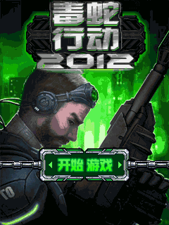 | Offline menu; paid play unverified | Partial | Title/menu, character selection, return navigation and fee prompt checked; paid gameplay unverified |
| 64 | `A/江湖Online(大型网游)V10.CBE` | 240×320 | 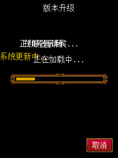 | Blocked: dead server | Blocked (online) | Online title: the guest requires the retired Coolbar platform service; the offline error page is the expected result (issue #126) |
| 65 | `A/法老祖玛(新品).CBE` | 240×320 | 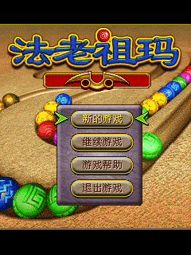 | Not assessed | Playable | Level select enters the Zuma track; confirm-key shots insert balls into the chain and the pause/return menu responds (issue #127) |
| 66 | `A/法老祖玛V10.CBE` | 240×320 |  | Not assessed | Boots only | Idle frame captured; interaction/gameplay unverified |
| 67 | `A/漂亮小护士(新品).CBE` | 240×320 |  | Not assessed | Playable | The ward grid renders with its countdown; pointer taps drive tile elimination and the pause menu responds (issue #128) |
| 68 | `A/漂亮小护士V10.CBE` | 240×320 | 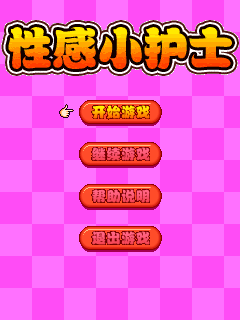 | Not assessed | Boots only | Idle frame captured; interaction/gameplay unverified |
| 69 | `A/漫画大王(新品).CBE` | 240×320 |  | Not assessed | Boots only | Title text renders; comic content and basic functionality unverified |
| 70 | `A/炸弹人(新品).CBE` | 240×320 |  | Not assessed | Playable | A confirm-key run reaches the stage and returns cleanly; later stages unverified |
| 71 | `A/热辣美图(新品).CBE` | 240×320 |  | Not assessed | Partial | Title, complete usage prompt and picture-browser navigation verified; remote downloads unverified |
| 72 | `A/爱之征途V101.CBE` | 240×320 | 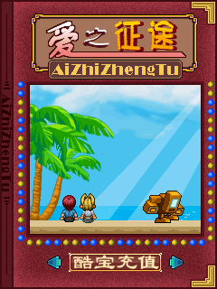 | Blocked: dead server | Blocked (online) | The title companion actor renders; the guest still requires the retired Coolbar service (issue #130) |
| 73 | `A/王牌伞兵(新品).CBE` | 240×320 | 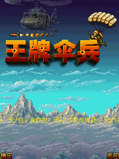 | Not assessed | Playable | A confirm-key run finishes cleanly and returns; later stages unverified |
| 74 | `A/王牌伞兵V10.CBE` | 240×320 | 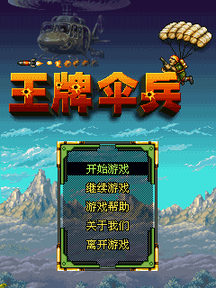 | Not assessed | Playable | A confirm-key run finishes cleanly and returns; later stages unverified |
| 75 | `A/生化危机(新品).CBE` | 320×240 | 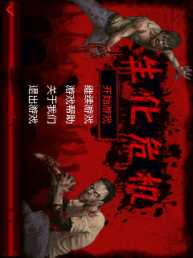 | Touch / keys | Playable | NIGHT1 renders characters and pickups; firing and weapon selection respond, and the run stays stable through 2,200 frames (issue #133) |
| 76 | `A/生化危机V10.CBE` | 320×240 |  | Touch / keys | Playable | NIGHT1 renders; input changes the ammo/weapon HUD (issue #134) |
| 77 | `A/生化危机V101.CBE` | 320×240 |  | Touch / keys | Playable | NIGHT1 spawns enemies that close on the player and clear by 1,200 frames; movement, weapon selection and the pause menu work in longer runs (issue #135) |
| 78 | `A/生肖宝贝(新品).CBE` | 240×320 | 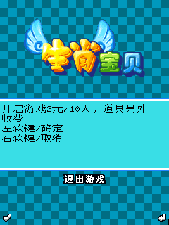 | Not assessed | Fails to start | Startup stays on a loading screen with unrelated failure text overlaid before any playable screen appears (issue #136) |
| 79 | `A/生肖运程V10.CBE` | 240×320 |  | Not assessed | Boots only | Image palette colors checked; interaction/gameplay unverified |
| 80 | `A/疯狂斗地主(新品).CBE` | 240×320 | 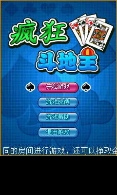 | Not assessed | Playable | Menu, help, card actions and one round result checked; the resumed deal renders hand, kitty, timer and score, and exit/re-entry returns to a complete main menu (issue #137) |
| 81 | `A/疯狂斗地主V10.CBE` | 240×320 |  | Not assessed | Playable | Billing return, character select and a real deal work — cards can be played and the opponent responds; the resumed deal renders correctly (issue #138) |
| 82 | `A/移动书城V10.CBE` | 240×320 |  | Not assessed | Boots only | Offline continuation frame captured; interaction/gameplay unverified |
| 83 | `A/穿越火线V101.CBE` | 240×320 |  | Not assessed | Boots only | Offline continuation frame captured; interaction/gameplay unverified |
| 84 | `A/绝密宝藏(新品).CBE` | 240×320 |  | Not assessed | Boots only | Renders a full screen; interaction unverified (issue #139) |
| 85 | `A/绝秘宝藏V10.CBE` | 240×320 |  | Not assessed | Boots only | Renders a full screen; interaction unverified (issue #140) |
| 86 | `A/绝秘宝藏V101.CBE` | 240×320 |  | Not assessed | Boots only | Offline continuation frame captured; interaction/gameplay unverified |
| 87 | `A/美女俄罗斯V10.CBE` | 240×320 |  | Not assessed | Boots only | Offline continuation frame captured; interaction/gameplay unverified |
| 88 | `A/美女拖拉机V10.CBE` | 240×320 |  | Not assessed | Partial | Title, menus and scene navigation verified; complete gameplay unverified |
| 89 | `A/联网五子棋(新版)V101.CBE` | 240×320 |  | Blocked: dead server | Blocked (online) | The boot parks on the platform update page and exits on its own timer — the modeled dead-platform result; rooms and play are unobtainable |
| 90 | `A/联网扎金花(新版)V101.CBE` | 240×320 |  | Blocked: dead server | Blocked (online) | The boot parks on the platform update page and exits on its own timer — the modeled dead-platform result; rooms and play are unobtainable |
| 91 | `A/联网拖拉机(新版)V101.CBE` | 240×320 |  | Blocked: dead server | Blocked (online) | The boot parks on the platform update page and exits on its own timer — the modeled dead-platform result; rooms and play are unobtainable |
| 92 | `A/联网斗地主(新版)V101.CBE` | 240×320 |  | Blocked: dead server | Blocked (online) | The boot parks on the platform update page and exits on its own timer — the modeled dead-platform result; rooms and play are unobtainable |
| 93 | `A/联网泡泡龙(新版)V101.CBE` | 240×320 |  | Blocked: dead server | Blocked (online) | The boot parks on the platform update page and exits on its own timer — the modeled dead-platform result; rooms and play are unobtainable |
| 94 | `A/联网麻将(强推)V101.CBE` | 240×320 |  | Blocked: dead server | Blocked (online) | The boot parks on the platform update page and exits on its own timer — the modeled dead-platform result; rooms and play are unobtainable |
| 95 | `A/象棋之唐伯虎点秋香V10.CBE` | 240×320 |  | Blocked: dead server | Blocked (online) | The full board renders and piece selection, the undo/save menu and move paths respond, but every play mode first demands an SMS purchase that posts to the retired Coolbar service (issue #148) |
| 96 | `A/贪吃鱼(经典).CBE` | 240×352 |  | Not assessed | Partial | Title/menu/help and basic selection checked; the underwater backdrop renders its full artwork. Complete gameplay unverified (issue #114) |
| 97 | `A/超级八十分(新品).CBE` | 240×320 |  | Not assessed | Partial | Character profiles display and switch, but no input combination leaves character select and no deal appears (issue #150) |
| 98 | `A/超级泡泡龙(新品).CBE` | 240×320 |  | Touch / keys | Partial | Title/menu, help/back, level selection and the game board verified; dismiss the startup offer before navigating. Firing effects and full gameplay unverified |
| 99 | `A/超级泡泡龙V10.CBE` | 240×320 |  | Touch / keys | Partial | Title/menu, help/back, the game board and numeric-5 firing with bubble removal and score verified; full gameplay unverified |
| 100 | `A/超级玛丽(新品).CBE` | 240×320 |  | Not assessed | Boots only | Level entry completes but the frame carries little content; rendered play unverified |
| 101 | `A/超级玛丽V10.CBE` | 240×320 |  | Not assessed | Playable | World 1-1 renders the player, terrain, clouds and HUD; the level scrolls as Mario walks and jumps clear the ledges, and the in-game menu opens. Verified across roughly three screens with Goombas, ? blocks and bricks; block coins, pipes and the level end unverified (issue #152) |
| 102 | `A/超级麻将(新品).CBE` | 240×320 |  | Not assessed | Partial | Title/menu rendering and basic selection checked; complete gameplay unverified |
| 103 | `A/超级麻将V10.CBE` | 240×320 |  | Not assessed | Partial | Title/menu and room selection verified; full rounds and online rooms unverified |
| 104 | `A/酷宝充值(短信直充)V101.CBE` | 240×320 |  | Required | Partial | Account/password form, numeric editing and password masking checked; online login and actual recharge unavailable |
| 105 | `A/金刚大战V10.CBE` | 240×320 |  | Not assessed | Playable | Dialogue renders line by line with a valued HUD; the claw collects ore for money and grabbing the bracelet clears the level with settlement; the stage-select screen starts the next level. Exact dialogue-advance keys and the stage-select return path unverified (issue #153) |
| 106 | `A/金字塔传奇(新品).CBE` | 240×320 |  | Not assessed | Partial | Title/menu rendering and basic selection checked; complete gameplay unverified |
| 107 | `A/金字塔传奇V101.CBE` | 240×320 |  | Not assessed | Boots only | Offline continuation frame captured; interaction/gameplay unverified |
| 108 | `A/陆小凤传奇V101.CBE` | 240×320 |  | Offline opening checked | Playable | Local billing enters combat; movement, attacks and shop navigation verified. Full campaign and purchases unverified |
| 109 | `A/雷霆战机(新品).CBE` | 240×320 |  | Not assessed | Fails to start | Loading prompt and ranking panel render, but after aircraft selection the guest reads resource data as code and normal startup never completes (issue #154) |
| 110 | `A/雷霆战机V10.CBE` | 240×320 |  | Not assessed | Boots only | Renders after formerly faulting; playable stages unverified (issue #155) |
| 111 | `A/马戏团(新品).CBE` | 240×320 |  | Not assessed | Playable | The tightrope and beach-ball phases, the 点播 continue, the in-game menu and the return to the title all verify cleanly. The About page is blank and the 存储游戏 item is inert (both game-side); hop-landing tolerance unverified (issue #156) |
| 112 | `A/马戏团V10.CBE` | 240×320 |  | Not assessed | Boots only | Idle frame captured; interaction/gameplay unverified |
| 113 | `A/马戏团V101.CBE` | 240×320 |  | Blocked: dead server | Blocked (online) | Online title: the guest requires the retired Coolbar platform service; the offline error page is the expected result (issue #157) |
| 114 | `A/魔兽塔防(新品).CBE` | 240×320 |  | Not assessed | Partial | The full TD map with build menu, tower stats and correct starting gold renders; the UI responds to input |
| 115 | `A/魔兽塔防V10.CBE` | 240×320 |  | Not assessed | Partial | Title/menu/help verified; the TD map renders with enemies walking the path and the build menu reachable |
| 116 | `A/魔力弹球(新品).CBE` | 240×320 |  | Not assessed | Partial | Title/menu rendering and basic selection checked; complete gameplay unverified |
| 117 | `A/魔塔(新品).CBE` | 240×320 |  | Not assessed | Playable | Story page and first-floor map render completely; movement, item pickup, stairs to floor 2, combat and the in-game menu verified. Full campaign and save/load unverified (issue #160) |
| 118 | `A/魔塔V10.CBE` | 240×320 |  | Not assessed | Partial | First-floor map, stairs, NPC and touch movement checked; later floors and combat unverified |
| 119 | `A/魔幻英雄(新品).CBE` | 240×320 |  | Not assessed | Playable | A confirm-key run reaches gameplay and returns cleanly; complete gameplay unverified |
| 120 | `A/魔幻英雄(新品)V10.CBE` | 240×320 |  | Not assessed | Boots only | Offline continuation frame captured; interaction/gameplay unverified |
| 121 | `A/魔幻英雄V101.CBE` | 240×320 |  | Blocked: dead server | Blocked (online) | Online title: the guest requires the retired Coolbar platform service; the offline error page is the expected result (issue #163) |
| 122 | `A/鹿鼎记(新品推荐)V10.CBE` | 240×320 |  | Not assessed | Playable | New-game confirmation, prologue and free-roam map with 菜单/系统 soft keys verified; held movement enters a new area and triggers a story event. Full story and save/load unverified (issue #164) |
| 123 | `A/龙王战士V101.CBE` | 240×320 |  | Blocked: dead server | Blocked (online) | Online title: the guest requires the retired Coolbar platform service; the offline error page is the expected result (issue #165) |

### Group B

| # | Application / file | Display | Screenshot | Network | Status | Notes |
| ---: | --- | --- | --- | --- | --- | --- |
| 1 | `B/AppStore.CBE` | 240×400 |  | Required | Boots only | Idle frame captured; interaction/gameplay unverified |
| 2 | `B/Google地图.CBE` | 240×400 |  | Required | Boots only | Packaged background renders; firmware-provided terms/title text unavailable; online operation unverified |
| 3 | `B/万年历.CBE` | 240×400 |  | No known requirement | Boots only | Idle frame captured; interaction/gameplay unverified |
| 4 | `B/三国群殴传.CBE` | 400×240 |  | No known requirement | Playable | Title → world map → briefing → tutorial-covered battle; a tile tap opens the unit panel, a purchased unit is placed with gold deducted, and the wave counter runs with combat underway; the pause menu and the confirm-to-title exit verified. The empty briefing box and grey portraits are shipped content (issue #166) |
| 5 | `B/世纪佳缘.CBE` | 240×400 |  | Required | Boots only | Idle frame captured; interaction/gameplay unverified |
| 6 | `B/众神之战.CBE` | 240×400 |  | No known requirement | Boots only | Idle frame captured; interaction/gameplay unverified |
| 7 | `B/僵尸先生.CBE` | 400×240 |  | No known requirement | Partial | The installer completes and the game reaches the title and the battle tutorial; battle-screen touch input (seed cards / lawn) is not yet registered (issue #167) |
| 8 | `B/割绳子.CBE` | 240×400 |  | No known requirement | Playable | Level select → 1-1; a drag cuts the rope, the candy falls through the stars into Om Nom, and the settlement, 下一关 and in-game menu respond (issue #168) |
| 9 | `B/割绳子冬季版.CBE` | 240×400 |  | No known requirement | Playable | Two rope cuts feed the candy into Om Nom; the 精彩! settlement with the new-record stamp and the menu respond (issue #169) |
| 10 | `B/动感骰子.CBE` | 240×400 |  | No known requirement | Boots only | The boot parks on the game's own 资费说明 page on the current build and scripted taps/soft keys do not dismiss it; the dice-table flow was verified on an earlier build (issue #170) |
| 11 | `B/吸血鬼猎人.CBE` | 400×240 |  | No known requirement | Partial | Battle loads with UI, background and turret; firing consumes ammo and the lamp glow plus ground shadows render smoothly; complete enemy combat unverified (issue #171) |
| 12 | `B/在线书城.CBE` | 240×400 |  | Required | Boots only | The boot reaches the account login page; online reading is unobtainable because the service is retired |
| 13 | `B/在线音乐.CBE` | 240×400 |  | Required | Boots only | Search controls, toolbars and the add prompt render; online operation unverified |
| 14 | `B/士兵突袭.CBE` | 400×240 |  | No known requirement | Partial | Left/right movement, jumping/climbing and exit-dialog cancellation checked; weapon switching, kills and full campaign unverified |
| 15 | `B/大家来数钱.CBE` | 240×400 |  | No known requirement | Partial | Difficulty selection, bill dragging, restart and return to title checked; full-round settlement and wealth accumulation unverified |
| 16 | `B/天气精灵.CBE` | 240×400 |  | Required | Boots only | Idle frame captured; interaction/gameplay unverified |
| 17 | `B/孤岛.CBE` | 240×400 |  | No known requirement | Boots only | Idle frame captured; interaction/gameplay unverified |
| 18 | `B/小酷.CBE` | 240×400 |  | No known requirement | Boots only | Idle frame captured; interaction/gameplay unverified |
| 19 | `B/小鸟愤怒冬季版.CBE` | 400×240 |  | No known requirement | Playable | Level grid → 1-1; a continuous slingshot drag (as with a real mouse) launches the bird, breaks the targets and lands LEVEL CLEARED with three stars; the next level unlocks and 1-2 is entered (issue #172). Audio and later levels unverified |
| 20 | `B/幸运扑克机.CBE` | 400×240 |  | No known requirement | Playable | Title → bet tutorial → first fast-forward deals, second reveals the hand; card faces render, holds toggle, unheld cards swap and the 猜大小 bonus screen appears (issue #173) |
| 21 | `B/开心大富翁.CBE` | 400×240 |  | No known requirement | Playable | Character/map selection and the skippable tutorial render; dice roll, token movement, property purchase prompts and the shop/minimap/exit menus respond (issue #174) |
| 22 | `B/忍者跳跃.CBE` | 240×400 |  | No known requirement | Playable | Tap-to-jump between the two walls with bird enemies, banners and the shield bubble rendering; pause/resume, the in-game menu and the height settlement respond (issue #175) |
| 23 | `B/性爱宝典.CBE` | 240×400 |  | No known requirement | Boots only | Disclaimer title, wrapped body and accept/reject labels render; interaction unverified |
| 24 | `B/性爱高手.CBE` | 240×400 |  | No known requirement | Boots only | Idle frame captured; interaction/gameplay unverified |
| 25 | `B/恶魔城.CBE` | 240×400 |  | No known requirement | Partial | Main menu labels and the 关于我们 page are correct; levels load with movement, camera scrolling and jumps (issue #176) |
| 26 | `B/恶魔城登录版.CBE` | 240×320 |  | Required | Boots only | Idle frame captured; interaction/gameplay unverified |
| 27 | `B/愤怒的小鸟.CBE` | 400×240 |  | No known requirement | Playable | The episode → level → slingshot chain runs end to end with the tutorial overlay showing the bird and pigs (issue #177) |
| 28 | `B/战争机器.CBE` | 240×400 |  | No known requirement | Partial | Title, menus and several story segments render; the scripted path stops at the HELLFIRE hint page and the guest halts, so no shooting scene is reachable (issue #178) |
| 29 | `B/打地鼠.CBE` | 240×400 |  | No known requirement | Playable | Moles pop up from the nine holes, scoring and the countdown run, and the RESULT page with score, best score and menu/replay buttons renders (issue #179) |
| 30 | `B/打火机.CBE` | 240×400 |  | No known requirement | Boots only | The boot parks on the game's own 资费说明 page and scripted taps/soft keys do not dismiss it; interaction/gameplay unverified |
| 31 | `B/捕鱼猎人.CBE` | 400×240 |  | No known requirement | Playable | Both modes reach the underwater scene; net firing costs a coin, the 挑战 countdown runs and scoring/pause/tutorial navigation are checked. Remaining guest-side gaps: 达人's clock stays at 01:00 and the exit dialog's 确定 leaves the dialog open (issue #180) |
| 32 | `B/新闻.CBE` | 240×400 |  | Required | Boots only | Idle frame captured; interaction/gameplay unverified |
| 33 | `B/时间同步.CBE` | 240×400 |  | Required | Boots only | Top icon/title missing; prompt renders |
| 34 | `B/暴力摩托.CBE` | 400×240 |  | No known requirement | Boots only | Idle frame captured; interaction/gameplay unverified |
| 35 | `B/暴打小猪.CBE` | 240×400 |  | No known requirement | Boots only | Idle frame captured; interaction/gameplay unverified |
| 36 | `B/机场指挥部.CBE` | 400×240 |  | No known requirement | Playable | Level 1 renders the airport with aircraft and HUD; drawing a route lands a plane for score; pause, menu, help pages, result restart and re-entry verified. Audio and later levels unverified (issue #181) |
| 37 | `B/极品飞车2012.CBE` | 240×400 |  | No known requirement | Boots only | Idle frame captured; interaction/gameplay unverified |
| 38 | `B/果蔬连连看.CBE` | 240×400 |  | No known requirement | Boots only | Idle frame captured; interaction/gameplay unverified |
| 39 | `B/枪之荣誉.CBE` | 240×352 |  | No known requirement | Boots only | Falls back offline to its menu and the menu text renders cleanly; interaction/gameplay unverified (issue #171) |
| 40 | `B/武林外传(新品).CBE` | 240×320 |  | No known requirement | Partial | Left/right movement, heavy-hit input, score acknowledgement and return to battle checked. Full campaign, battle exit and audio unverified |
| 41 | `B/武林外传V10.CBE` | 240×320 |  | No known requirement | Fails to start | Currently renders a black 载入中 screen — a regression from a recent screen-lifecycle change; a fix is pending |
| 42 | `B/歪歪猫发条城历险记V100.CBE` | 176×220 |  | Required | Boots only | The boot parks on the platform 系统更新中 page on the current build; platform movement, weapon firing and inventory selection were verified on earlier builds |
| 43 | `B/水果达人.CBE` | 400×240 |  | No known requirement | Playable | Fruit slicing with score and best score, pause/resume, settlement, retry and ten return/re-entry loops verified, plus Zen/Arcade modes and the achievements list (issue #183) |
| 44 | `B/江湖Online.CBE` | 240×400 |  | Required | Fails to start | Stuck on the server-communication screen after installation; cancelling leaves a blank green background (issue #184) |
| 45 | `B/法老祖玛2.CBE` | 400×240 |  | No known requirement | Playable | Level 1-1 renders the bead chain in colour; the tray drag, shot-colour switch and firing all work; the pause actions, exit dialog and continue-progress restart respond. Matching/popping and later chapters unverified (issue #185) |
| 46 | `B/涂鸦跳跃.CBE` | 240×352 |  | No known requirement | Boots only | Idle frame captured; interaction/gameplay unverified |
| 47 | `B/消息盒子.CBE` | 240×400 |  | No known requirement | Boots only | Idle frame captured; interaction/gameplay unverified |
| 48 | `B/激情砖块.CBE` | 240×400 |  | No known requirement | Partial | Level 1 after the loading/story prompts; paddle drag, ball motion, pause, retry and return to map verified. Full levels, boss, shop and audio unverified |
| 49 | `B/火辣美女视频.CBE` | 240×400 |  | Required | Boots only | Idle frame captured; interaction/gameplay unverified |
| 50 | `B/炫酷音乐彩铃.CBE` | 240×400 |  | Required | Boots only | Idle frame captured; interaction/gameplay unverified |
| 51 | `B/热辣美图.CBE` | 240×400 |  | No known requirement | Boots only | Idle frame captured; interaction/gameplay unverified |
| 52 | `B/牧场物语.CBE` | 240×400 |  | No known requirement | Playable | Title and story pages lead to character selection, the village tour and the farm field with HUD; a right-hold scrolls the map. The platform login probe falls back to offline mode. Planting, tools and shop flows unverified (issue #186) |
| 53 | `B/猫和老鼠.CBE` | 240×400 |  | No known requirement | Boots only | Idle frame captured; interaction/gameplay unverified |
| 54 | `B/现代情趣大全.CBE` | 240×400 |  | No known requirement | Boots only | Idle frame captured; interaction/gameplay unverified |
| 55 | `B/电子邮件.CBE` | 240×400 |  | Required | Boots only | Idle frame captured; interaction/gameplay unverified |
| 56 | `B/疯狂企鹅大冒险.CBE` | 400×240 |  | No known requirement | Partial | Tutorial, level select and level 1 run with movement, jumping and item pickups; the failure screen, re-entry and return to the main menu verified. Later levels unverified (issue #187) |
| 57 | `B/疯狂捕鸟.CBE` | 400×240 |  | No known requirement | Playable | Cannon, bird flocks and net firing with coin cost/reward all work; the pause menu's four items navigate and 确定 in the exit dialog exits cleanly (issue #188) |
| 58 | `B/疯狂斗地主.CBE` | 400×240 |  | No known requirement | Boots only | Idle frame captured; interaction/gameplay unverified |
| 59 | `B/皇牌空战.CBE` | 240×400 |  | No known requirement | Boots only | Idle frame captured; interaction/gameplay unverified |
| 60 | `B/碰嘭球.CBE` | 240×400 |  | No known requirement | Playable | Board, launcher, menu, firing, pop clearing and scoring all work, including returning to level select and re-entering repeatedly (issue #189) |
| 61 | `B/移淘网.CBE` | 240×400 |  | Required | Boots only | Idle frame captured; interaction/gameplay unverified |
| 62 | `B/笑死人.CBE` | 240×400 |  | No known requirement | Boots only | Idle frame captured; interaction/gameplay unverified |
| 63 | `B/美女桌球.CBE` | 400×240 |  | No known requirement | Playable | Character/level select, tutorial, drag-to-aim, charged shots and the 保存退出 continue save verified. Character-select portraits are missing because the CBE file itself lacks those image bytes (issue #190) |
| 64 | `B/英汉词典.CBE` | 240×400 |  | No known requirement | Boots only | Idle frame captured; interaction/gameplay unverified |
| 65 | `B/血剑Online.CBE` | 240×400 |  | Required | Fails to start | The login page renders but typed input never opens an editor; the billing kernel then stops on its mandatory update page — the offline-faithful result (issue #191) |
| 66 | `B/钻石迷情3.CBE` | 240×400 |  | No known requirement | Partial | Classic mode matches and swaps with scoring, and returning to the title and re-entering no longer blacks out (issue #192) |
| 67 | `B/雄霸天下.CBE` | 240×400 |  | Required | Fails to start | The online flow reports server interruption and never shows characters or gameplay; the billing kernel's update page is the offline-faithful result (issue #193) |
| 68 | `B/雷电.CBE` | 240×400 |  | No known requirement | Boots only | Idle frame captured; interaction/gameplay unverified |
| 69 | `B/雷霆战机.CBE` | 240×400 |  | No known requirement | Boots only | Idle frame captured; interaction/gameplay unverified |
| 70 | `B/马戏团.CBE` | 240×400 |  | No known requirement | Boots only | Idle frame captured; interaction/gameplay unverified |
| 71 | `B/鬼吹灯.CBE` | 240×400 |  | No known requirement | Partial | New game → introduction → first level renders map, characters and dialogue; movement scrolls the scene and the in-game reset keeps the character in play. Full level, key collection and audio unverified (issue #194) |
| 72 | `B/魔兽塔防.CBE` | 240×400 |  | No known requirement | Boots only | Idle frame captured; interaction/gameplay unverified |
| 73 | `B/魔塔.CBE` | 240×400 |  | No known requirement | Boots only | Idle frame captured; interaction/gameplay unverified |
| 74 | `B/魔鬼理发师.CBE` | 240×400 |  | No known requirement | Boots only | Idle frame captured; interaction/gameplay unverified |

### Group C

| # | Application / file | Display | Screenshot | Network | Status | Notes |
| ---: | --- | --- | --- | --- | --- | --- |
| 1 | `C/Almanac.CBE` | 176×220 |  | Not assessed | Boots only | Offline error panel renders; interaction and online content unverified |
| 2 | `C/Apotheosize.CBE` | 176×220 |  | Not assessed | Partial | Opening dialogue, palace movement, menus and save confirmation checked; combat, later maps and full campaign unverified |
| 3 | `C/BombMan.CBE` | 176×220 |  | Not assessed | Boots only | Idle frame captured; gameplay unverified |
| 4 | `C/Bowling.CBE` | 176×220 |  | Not assessed | Boots only | Idle frame captured; gameplay unverified |
| 5 | `C/brick.CBE` | 176×220 |  | Not assessed | Playable | Local billing grants coins; level 1 plays from any serve order — the ball clears bricks, scores and re-serves after a life loss (issue #195) |
| 6 | `C/Car.CBE` | 176×220 |  | Not assessed | Partial | Track/car selection, race start, acceleration, steering and nitro use checked; complete race, campaign and audio unverified |
| 7 | `C/Cartoon.CBE` | 176×220 |  | Not assessed | Boots only | Idle frame captured; interaction/gameplay unverified |
| 8 | `C/DaimonCastle.CBE` | 176×220 |  | Not assessed | Boots only | Idle frame captured; gameplay unverified |
| 9 | `C/Deluxe.CBE` | 176×220 |  | Not assessed | Boots only | Idle frame captured; gameplay unverified |
| 10 | `C/dragon.CBE` | 176×220 |  | Not assessed | Bad game file | The defect is in the game data itself — the play run cannot be repaired on the emulator side (issue #197) |
| 11 | `C/Ebook.CBE` | 176×220 |  | Not assessed | Partial | Bookshelf and directional selection checked; the native viewport is incomplete; remote books unavailable |
| 12 | `C/Eden.CBE` | 176×220 |  | Not assessed | Boots only | Idle frame captured; interaction/gameplay unverified |
| 13 | `C/Email.CBE` | 176×220 |  | Not assessed | Boots only | Idle frame captured; interaction/gameplay unverified |
| 14 | `C/Fighter.CBE` | 176×220 |  | Not assessed | Boots only | Idle frame captured; gameplay unverified |
| 15 | `C/Garden.CBE` | 176×220 |  | Not assessed | Boots only | Idle frame captured; gameplay unverified |
| 16 | `C/GoldMan.CBE` | 176×220 |  | Not assessed | Boots only | Idle frame captured; gameplay unverified |
| 17 | `C/happySheep.CBE` | 176×220 |  | Not assessed | Boots only | Idle frame captured; gameplay unverified |
| 18 | `C/HellRaider.CBE` | 176×220 |  | Not assessed | Boots only | Idle frame captured; gameplay unverified |
| 19 | `C/HitLand.CBE` | 176×220 |  | Not assessed | Boots only | Idle frame captured; gameplay unverified |
| 20 | `C/Im.CBE` | 176×220 |  | Required for online login | Partial | Login screen and field-focus navigation checked; online authentication unavailable |
| 21 | `C/kriegspiel.CBE` | 176×220 |  | Not assessed | Boots only | Idle frame captured; gameplay unverified |
| 22 | `C/MaJiang.CBE` | 176×220 |  | Not assessed | Boots only | Idle frame captured; interaction/gameplay unverified |
| 23 | `C/Map.CBE` | 176×220 |  | Not assessed | Boots only | Map grid, center marker and bottom menu render; online map data unverified |
| 24 | `C/mario.CBE` | 176×220 |  | Not assessed | Playable | World 1-1 with walking/jumping, blocks/pipes/coins with a live counter, lives lost and stage restart, in-game menus and the extra-lives offer (issue #198). Later stages, pipe warps and audio unverified |
| 25 | `C/MetalSlug.CBE` | 176×220 |  | Not assessed | Partial | First-stage movement, jumping, firing and menus checked; complete stages and audio unverified |
| 26 | `C/MoTa.CBE` | 176×220 |  | Not assessed | Boots only | Idle frame captured; gameplay unverified |
| 27 | `C/MyGirl.CBE` | 176×220 |  | Not assessed | Boots only | Idle frame captured; gameplay unverified |
| 28 | `C/netgobang.CBE` | 176×220 |  | Not assessed | Fails to start | Login rejects empty credentials, but typed input never fills the fields, so login/registration never proceed (issue #199) |
| 29 | `C/netGoldFlower.CBE` | 176×220 |  | Not assessed | Fails to start | Fields take focus but typed input never fills them; login/registration never proceed (issue #200) |
| 30 | `C/Picview.CBE` | 176×220 |  | Not assessed | Boots only | Idle frame captured; interaction/gameplay unverified |
| 31 | `C/Pocker.CBE` | 176×220 |  | Not assessed | Boots only | Idle frame captured; interaction/gameplay unverified |
| 32 | `C/Precious.CBE` | 176×220 |  | Not assessed | Boots only | Idle frame captured; gameplay unverified |
| 33 | `C/Rich.CBE` | 176×220 |  | Not assessed | Bad game file | The defect is in the game data itself — the map load cannot be repaired on the emulator side (issue #201) |
| 34 | `C/Ringside.CBE` | 176×220 |  | Not assessed | Boots only | Idle frame captured; gameplay unverified |
| 35 | `C/RussBlock.CBE` | 176×220 |  | Not assessed | Boots only | Idle frame captured; gameplay unverified |
| 36 | `C/Sanbing.CBE` | 176×220 |  | Not assessed | Boots only | Idle frame captured; gameplay unverified |
| 37 | `C/Star.CBE` | 176×220 |  | Not assessed | Boots only | Idle frame captured; gameplay unverified |
| 38 | `C/Stock.CBE` | 176×220 |  | Not assessed | Boots only | Menu no longer clipped; gameplay unverified |
| 39 | `C/SuperAirship.CBE` | 176×220 |  | Not assessed | Boots only | Idle frame captured; gameplay unverified |
| 40 | `C/Sxbaby.CBE` | 176×220 |  | Not assessed | Boots only | Idle frame captured; gameplay unverified |
| 41 | `C/TankWar.CBE` | 176×220 |  | Not assessed | Boots only | Idle frame captured; gameplay unverified |
| 42 | `C/TD.CBE` | 176×220 |  | Not assessed | Boots only | Idle frame captured; gameplay unverified |
| 43 | `C/TF.CBE` | 176×220 |  | Not assessed | Boots only | Idle frame captured; gameplay unverified |
| 44 | `C/Train.CBE` | 176×220 |  | Not assessed | Boots only | Menu no longer clipped; gameplay unverified |
| 45 | `C/UniversalWar.CBE` | 176×220 |  | Not assessed | Boots only | Idle frame captured; gameplay unverified |
| 46 | `C/Weather.CBE` | 176×220 |  | Not assessed | Boots only | Idle frame captured; interaction/gameplay unverified |
| 47 | `C/Zombie.CBE` | 220×176 |  | Not assessed | Boots only | Automatic landscape 220×176; gameplay unverified |
| 48 | `C/ZuMa.CBE` | 176×220 |  | Not assessed | Boots only | Menu no longer clipped; gameplay unverified |

## Known Limitations

- Some titles stop with guest faults during startup; each is noted in its row.
- Firmware interfaces are incomplete; a successful idle run does not certify
  paths reached only through later input.
- Network services answer with offline responses. Remote content, original
  online sessions and carrier billing are unavailable. Guest file writes are
  not persisted to host storage; host sidecar files load read-only.
- Continuation timers advance without retry waits after offline channel or
  HTTP errors; normal game timers keep their pace.
- Complete playthroughs, every character/stage and all audio paths are not
  validated; file-based MP3 control is incomplete.
- Save states restore guest memory and execution, but host-side virtual
  files, pending network/billing callbacks and the random generator state
  are not serialized.

## Reporting a Compatibility Issue

Include the group, filename, resolution, last visible screen, triggering input
and error text. Reproduce with `cbe_boot` and scripted phone keys where possible.
Do not attach copyrighted game packages to public reports.

```bash
cargo run --release -p coolbaremu-tools --bin cbe_boot -- \
  path/to/game.CBE --frames 200 --key-event 1:14 --screenshot frame.png
```

Use `CBE_TRACE=all` or selected services such as `CBE_TRACE=4:24,6:3` for diagnostics.
