# Game Compatibility

## Current Status

The local validation corpus contains 245 distinct CBE files in three groups: A (123), B
(74), and C (48). Group identifiers distinguish archive variants, including
applications with the same name. Game files are supplied separately and are not
included in this repository. Table filenames use group-relative paths such as
`A/`, `B/`, and `C/`. These collection groups do not identify handset models.
Byte-identical archives are retained once,
with group priority B, then C, then A; differently encoded variants remain separate.

The tables below record the current core's 200-frame idle execution and captured
RGB565 frame. Each callback permits 100,000,000 instructions; each file has a
90-second wall-clock protection by default, and no capture needs it raised. The
slowest is `B/疯狂企鹅大冒险.CBE` at about 81 s: it rebuilds its scene buffers every
frame, so the bump-only allocator used to run the 4 MiB pool dry and the 200-frame
capture took 172 s. Once the block allocator started recycling freed runs
(b441741) it stopped starving itself of memory and came back under the default
limit. `B/僵尸先生.CBE` and `B/激情砖块.CBE` no longer need the extension either —
they finish in about 30 s and 22 s with the same build.
An execution result is not a gameplay rating.
`Ready` means the machine remains active; `Halted` means guest execution stopped.
The current CoolbarEmu captures contain 243 `Ready` and two `Halted` results,
with no execution failures or timeouts across the 245 files.
A captured image may be a loading screen or prompt. Blank frames and guest
assertion halts do not establish usable startup. Interaction is unverified unless
explicitly listed in the Coverage / limitation column. Bookstore B retains its verified offline failure prompt and deliberate timed exit;
online reading remains unverified. Zombie Master V101 reaches its landscape
title menu. Music (recommended) V101 stops after offline continuation; usable
startup is unverified. SMS Recharge V101 reaches its numeric account/password
form. Six online-game V101 variants reach fully interactive login screens — taps,
soft keys and arrows all register, the 资费说明 page opens — but 快速登陆 only opens the
retired Coolbar lobby channel `ghlc.51coolbar.com:20050` (a RFC 2544 placeholder
A record), so authentication, rooms and multiplayer games remain unobtainable. 坦克大战 V10
(A group, row 29) is a ROM-level defect rather than an emulation gap: its
hard-coded screen descriptor names a data blob inside the code image as the
screen logic routine, so its play run cannot be repaired host-side (issue #103,
closed as won't-fix). Rich (C group, row 33) is likewise a ROM-level defect: its
resource handler is a single-use form that both the game itself and the standard
screen lifecycle invoke without re-seeding, so the map load reads the name pool
past the stack top and divides by zero; it cannot be repaired host-side (issue
#201, closed as won't-fix). Dragon (C group, row 10) is the third: its image
library leaves slot 18 uninitialised, so the divide that follows reads a zero
width; the archive carries the defect, not the emulator (issue #197, closed as
won't-fix). Those three, plus the 19 online titles whose only entry path is a
retired Coolbar service, are the complete set of archives the host cannot make
playable, and their issues are closed to keep the board to real work.
Bejeweled 3 (B group, row 66) had a host-side gap in the picture-release path:
the game LCD slot that clears an image header never reclaimed the pixel
allocation, so returning to the title leaked every decoded picture and a later
re-entry found the heap pool full and rendered black; the slot now frees the
allocation (b75283f), and re-entry across three cycles plus a scoring swap is
verified (issue #192).

## Summary

| Group | Files | Execution completed | Execution failed | Timed out |
| --- | ---: | ---: | ---: | ---: |
| A | 123 | 123 | 0 | 0 |
| B | 74 | 74 | 0 | 0 |
| C | 48 | 48 | 0 | 0 |

Verified interaction includes Wulin's menus and battle actions, one Crazy
Landlord round, War Chess's menu/help/purchase panels, Westward Journey's title
menu, the QCIF Ebook bookshelf, and Love Assistant V10 list menus and article
selection/back navigation, plus IM login rendering and field-focus navigation.
Fish Classic title/menu and help navigation are also checked.
Zombie Master (recommended variant) title/menu, touch selection, help text and
return navigation are checked with its supplied companion resources.
1943 V101 reaches aircraft/equipment selection and battle through local point-play
billing simulation. War Chess V101 displays the same local receipt; its battle
path remains unverified. Flying Eagle V101 reaches its introduction through local
SMS billing, but starting flight still faults during map loading.
In 1943, acknowledge the receipt with the right soft key (`E`), then use the
left soft key (`Q`) to open equipment and confirm the sortie.
Servers are treated as unavailable. Continuation timers used after offline channel
or HTTP POST errors advance without retry waits to avoid prolonged startup update
prompts. Normal game timers and GET error handling retain their pace.
Variant-specific coverage is listed below.
Fifteen embedded-program variants restore normal title/menu rendering and basic
selection through 2,000-frame input checks. Active but blank/loading variants
remain incomplete, as specified in their individual rows.
Complete playthroughs and all audio paths remain unverified; billing and network
callbacks are local offline simulations.

## Application List

Screenshots use separate A/B/C image directories to avoid filename collisions.
The Display column records the active output dimensions after orientation;
startup clips take precedence over inferred clears. Unidentified modes retain
the 240×400 fallback. Correct dimensions alone do not establish correct rendering.
“Required” denotes an established network dependency; “Not assessed” means the
dependency has not been verified for that archive variant. Offline callbacks do
not provide the original server's content or a real carrier payment service.

### Group A

| # | Application / file | Display | Screenshot | Network | Execution | Coverage / limitation |
| ---: | --- | --- | --- | --- | --- | --- |
| 1 | `A/1943命运之决战V101.CBE` | 240×320 | 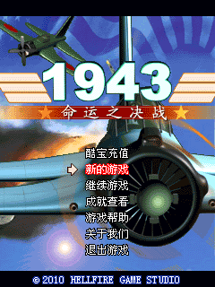 | Local billing simulation | Ready | Local point-play receipt, aircraft/equipment selection, battle start, directional movement, firing and retry flow checked; sequential review replayed battle/movement/fire at 205 frames and retry at 560 frames without faults; full campaign and audio unverified |
| 2 | `A/三国大富翁(新品).CBE` | 240×320 |  | Not assessed | Ready | Title/menu, help text, scrolling and back navigation checked for 2,000 frames; service 72 native tile-map fix (9c021ca): character-select screen (博望坡 scene, 6 characters) renders, map object and picture library verified by memory dump, in-game store menu, help screen and 0元 fee dialog interactive, burst confirms at frames 200–250 advance the start prompt, stable 2,000-frame run; board area renders dark behind in-game menus (identical map data/objects verified vs V10, guest-side difference; heap-relocated code, not ROM-disassemblable). |
| 3 | `A/三国大富翁V10.CBE` | 240×320 | 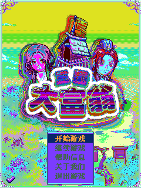 | Not assessed | Ready | Image palette colors checked; service 72 native tile-map fix (9c021ca): the loading screen needs repeated Confirm presses (every 20 frames) to advance — not an emulator deficiency; location scene (grass/path/三国 sign) renders behind in-game menus (保存游戏/帮助信息/返回菜单), store and system menus work, local billing dialog correct (信息费0元，拥有800点券). |
| 4 | `A/三国志(新品)V10.CBE` | 240×320 | 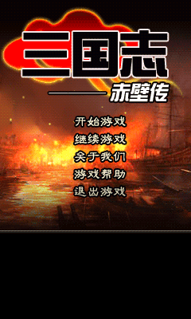 | Not assessed | Ready | Local SMS billing reaches story dialogue; subsequent map loading faults; battle unavailable |
| 5 | `A/三国志@火.CBE` | 240×320 |  | Not assessed | Ready | Loading message renders; basic startup incomplete |
| 6 | `A/三国志V101.CBE` | 240×320 | 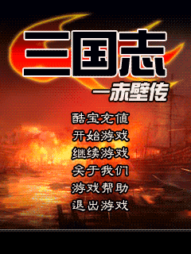 | Local receipt; battle unverified | Ready | Title/menu, help, game introduction and the local point-play receipt are checked; after the receipt is acknowledged the render falls from 76,788 px to 291 px and then to 0 although the game screen descriptor is byte-identical at frames 260/325/400 and its logic pointer 0x043E8ACD is intact, so the guest itself decides there is nothing left to draw and battle is unreachable (issue #86) |
| 7 | `A/俄罗斯方块(免费).CBE` | 240×320 | 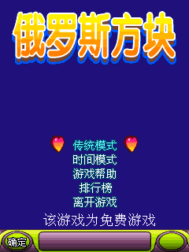 | Not assessed | Ready | Title/menu rendering and basic selection checked for 2,000 frames; complete gameplay unverified |
| 8 | `A/傲气雄鹰V101.CBE` | 240×320 | 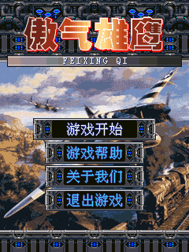 | Offline menu; paid play unavailable | Ready | Local SMS billing reaches flight introduction; starting play faults during map loading; flight unavailable |
| 9 | `A/僵尸先生(强推).CBE` | 320×240 | 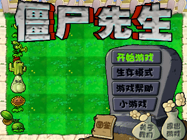 | No known requirement | Ready | Title/menu, touch selection, help text and return verified for 2,000 frames with supplied companion resources; seed selection accepts peas, sunflowers and potatoes but the plantable lawn is never reached, and CBE-only installation stays unverified (issue #88) |
| 10 | `A/僵尸先生(新品)V10.CBE` | 320×240 |  | Not assessed | Ready | Blank dark-red panel after 开始 fixed by implementing the game-lcd IMG_DrawChar service 16:10 (#89 still open: the story page now renders and the plant chooser, selection/purchase and pause menu all respond, but the battle scene after 开始游戏 on the chooser does not blit); gameplay beyond the chooser unverified |
| 11 | `A/僵尸先生V101.CBE` | 320×240 | 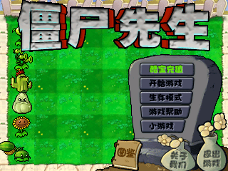 | Blocked: dead server | Ready | Online title: the guest requests the retired Coolbar platform service (vmt.51coolbar.com) and the offline error page is the firmware-faithful result; emulator-side fix is not possible (see issue #90) |
| 12 | `A/动感保龄球.CBE` | 240×320 |  | Not assessed | Ready | Title/menu rendering and basic selection checked for 2,000 frames; complete gameplay unverified |
| 13 | `A/卧底风云(精品).CBE` | 240×320 |  | Not assessed | Ready | Playable: 150-frame confirm-key run reaches the street (72192 px / 89 colors) and returns through `EXIT_ADDRESS`; the shared f7ba663 repair removed the null actor/controller call that stopped it; later stages and audio unverified
| 14 | `A/卧底风云V10.CBE` | 240×320 | 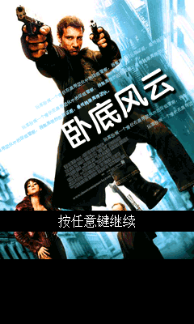 | Not assessed | Ready | Playable: 150-frame confirm-key run reaches the street (71760 px / 50 colors) and returns through `EXIT_ADDRESS`; the scene null-method call is repaired; later stages unverified
| 15 | `A/卧底风云V101.CBE` | 240×320 | 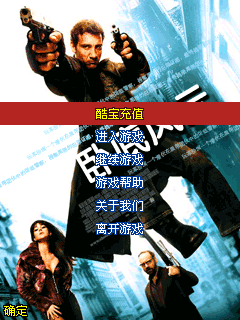 | Blocked: dead server | Ready | Online title: the guest requests the retired Coolbar platform service (vmt.51coolbar.com) and the offline error page is the firmware-faithful result; emulator-side fix is not possible (see issue #93) |
| 16 | `A/原罪天使V101.CBE` | 240×320 | 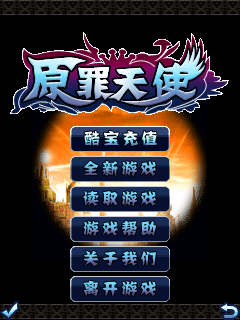 | Blocked: dead server | Ready | Online title: the guest requests the retired Coolbar platform service (vmt.51coolbar.com) and the offline error page is the firmware-faithful result; emulator-side fix is not possible (see issue #94) |
| 17 | `A/双截龙(新品).CBE` | 240×320 | 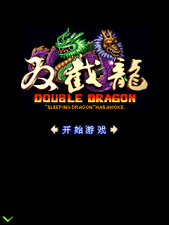 | Not assessed | Ready | Level 1-1 loads with rooms, pickups and HUD and the life value reacts to attack input, but the player and enemies stay invisible apart from a clipped red smear in the top-left corner (issue #95) |
| 18 | `A/双截龙V10.CBE` | 240×320 | 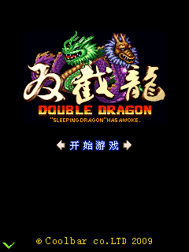 | Not assessed | Ready | The 1-1 tutorial runs and the HUD/life values update, but the world area is black with purple horizontal bars and no character is visible (issue #96) |
| 19 | `A/变形金刚(新品).CBE` | 240×320 |  | Not assessed | Ready | Service 72 native tile-map fix (9c021ca): tutorial dialog renders, road/pipe puzzle grid with placed pieces renders, piece selector UI interactive. |
| 20 | `A/合金装备(新品).CBE` | 240×320 | 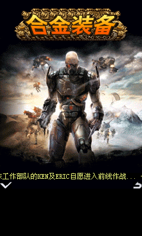 | Not assessed | Ready | Title content renders; continuation input and gameplay unverified |
| 21 | `A/合金装备V10.CBE` | 240×320 |  | Not assessed | Ready | Local SMS billing reaches terrain/HUD/tutorial; later controller method call faults; gameplay unavailable |
| 22 | `A/合金装备V101.CBE` | 240×320 | 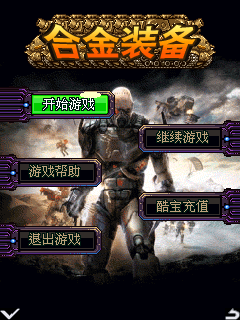 | Not assessed | Ready | Offline continuation frame captured; interaction/gameplay unverified |
| 23 | `A/喜羊羊与灰太狼@新.CBE` | 240×320 |  | Not assessed | Ready | Numeric HUD restored; touch shooting and special items raise score to20 and eliminate a wolf; 2,000-frame replay reaches the native death/retry prompt and Back returns to level selection without faults; full campaign/audio unverified |
| 24 | `A/喜羊羊与灰太狼V10.CBE` | 240×320 |  | Not assessed | Ready | Local SMS billing simulation enters shooting play; shots/special items yield score20 and one eliminated wolf; 2,500-frame native life-purchase prompt and Back to level selection checked without faults; full campaign/audio unverified |
| 25 | `A/噗噜噗噜旋转棒V101.CBE` | 240×320 |  | Blocked: dead server | Ready | Online title: the guest requests the retired Coolbar platform service (dl.kvbar.com) and the offline error page is the firmware-faithful result; emulator-side fix is not possible (see issue #101) |
| 26 | `A/在线书城(新品).CBE` | 240×320 |  | Required for online content | Ready | Title, toolbar and directional selection verified for 2,000 frames; online content and request completion unverified |
| 27 | `A/在线书城V10.CBE` | 240×320 | 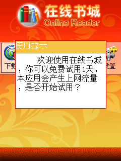 | Not assessed | Ready | Book background/icons and usage prompt render; font/layout differences remain; interaction unverified |
| 28 | `A/坦克大战(新品).CBE` | 240×320 |  | Not assessed | Ready | Playable: 150-frame confirm-key run completes the scene (15353 px / 142 colors) and returns through `EXIT_ADDRESS`; the same shared repair removed the PC=0 fetch; controls and later stages unverified
| 29 | `A/坦克大战V10.CBE` | 240×320 | 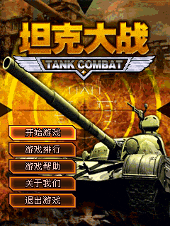 | Not assessed | Ready | ROM defect — not repairable host-side: the hard-coded screen descriptor at 0x043F59E0 names `0x043E79AD` as its logic routine, which lands in a data blob inside the code image (verified byte-identical to the archive, never rewritten at run time); the run stops with `unsupported ARM instruction at 0x043E7322`. See issue #103.
| 30 | `A/坦克大战V101.CBE` | 240×320 |  | Blocked: dead server | Ready | Online title: the guest requests the retired Coolbar platform service (vmt.51coolbar.com) and the offline error page is the firmware-faithful result; emulator-side fix is not possible (see issue #104) |
| 31 | `A/士兵突袭(精品).CBE` | 240×320 | 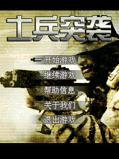 | Not assessed | Ready | Title/menu rendering and basic selection checked for 2,000 frames; complete gameplay unverified |
| 32 | `A/士兵突袭V10.CBE` | 240×320 |  | Not assessed | Ready | Loading-stage NULL dispatch and division by zero fixed (#106 still open: scene window scroll slots, picture-library `-1` size); the stage itself still renders blank and gameplay is unverified (issue #106) |
| 33 | `A/大唐双龙(新品)V101.CBE` | 240×320 |  | Blocked: dead server | Ready | Online title: the guest requests the retired Coolbar platform service (vmt.51coolbar.com) and the offline error page is the firmware-faithful result; emulator-side fix is not possible (see issue #107) |
| 34 | `A/大话西游(新品).CBE` | 240×400 | 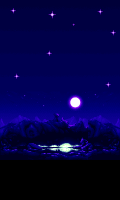 | Not assessed | Ready | Title and menu render and input is checked; the third tap on 确定 at frame 80 runs a 9.1M-instruction one-shot after which the guest closes its last screen, so that run ends Halted (the idle capture stays Ready) with the centre menu panel never populated (issue #108) |
| 35 | `A/大话西游V10.CBE` | 240×320 |  | Not assessed | Ready | Confirm advances past the story into a level HUD and an EXCELLENT banner, but the play area shows only a starfield and the blue dialog is empty; the pause menu opens and closes with input (issue #109) |
| 36 | `A/太空堡垒(新品).CBE` | 240×320 | 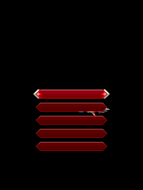 | Not assessed | Ready | Playable: 150-frame confirm-key run finishes Ready (24751 px / 107 colors) and returns through `EXIT_ADDRESS`; the level-start null object call is repaired; later stages unverified
| 37 | `A/太空堡垒V10.CBE` | 240×320 | 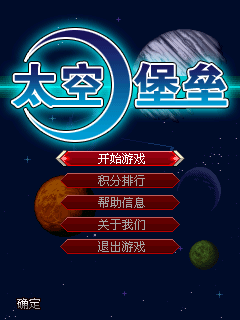 | Not assessed | Ready | Playable: 150-frame confirm-key run finishes Ready (24751 px / 107 colors) and returns through `EXIT_ADDRESS`; the level-start null object call is repaired; later stages unverified
| 38 | `A/封神演义(新品).CBE` | 240×320 | 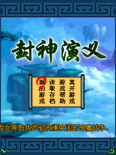 | Not assessed | Ready | Playable: 150-frame confirm-key run finishes Ready (61440 px / 61 colors) and returns through `EXIT_ADDRESS`; the scene-load null address call is repaired; later stages unverified
| 39 | `A/封神演义V10.CBE` | 240×320 | 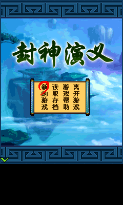 | Not assessed | Ready | Playable: 150-frame confirm-key run finishes Ready (61440 px / 61 colors) and returns through `EXIT_ADDRESS`; the scene-load null address call is repaired; later stages unverified
| 40 | `A/封神演义V101.CBE` | 240×320 | 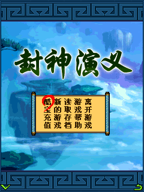 | Not assessed | Ready | Title renders, but early and late Confirm, both soft keys, the numeric action/direction keys and taps all fail to leave it — it is still the title at 1,200 frames (issue #114) |
| 41 | `A/小酷V10.CBE` | 240×320 |  | Not assessed | Ready | Idle frame captured; interaction/gameplay unverified |
| 42 | `A/小酷V101.CBE` | 240×320 |  | Required | Ready | Offline startup advances past update prompt; waiting screen, timeout popup and single dismissal checked; subsequent Back can fault, and message text and usable online content are missing |
| 43 | `A/小酷书城(免费看书)V101.CBE` | 240×320 |  | Not assessed | Ready | Offline continuation frame captured; interaction/gameplay unverified |
| 44 | `A/小酷农场(火爆上线)V10.CBE` | 240×320 | 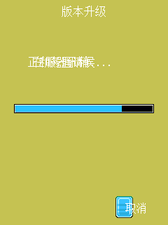 | Not assessed | Ready | Start shows the version-upgrade and network-failure page with only 确定; Confirm, soft keys, taps and back-retries never reach the farm by 1,000 frames (issue #115) |
| 45 | `A/小酷音乐(强推)V101.CBE` | 240×320 |  | Not assessed | Halted | Guest stops after offline continuation; usable startup and online content unverified |
| 46 | `A/开心花园(新品).CBE` | 240×320 |  | Not assessed | Ready | Seeding, the diary and field entry work — direction input moves the counter 62→61 and coins 0→5 and the hole markers move — but no player character or action is recognisable; still Ready at 2,200 frames (issue #116) |
| 47 | `A/恋爱助手V10.CBE` | 240×320 |  | Not assessed | Ready | List menu, submenu, article selection, scrolling and back navigation verified; billing callbacks are simulated offline |
| 48 | `A/恶魔城(新品).CBE` | 240×320 | 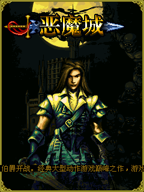 | Not assessed | Ready | Playable: 150-frame confirm-key run reaches the first stage (70110 px / 119 colors) and returns through `EXIT_ADDRESS`; the host now answers the resource size request with a count instead of a heap block; complete gameplay unverified
| 49 | `A/恶魔城V10.CBE` | 240×320 | 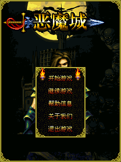 | Not assessed | Ready | Playable: 150-frame confirm-key run reaches the first stage (70110 px / 119 colors) and returns through `EXIT_ADDRESS`; the unreachable method slot is treated as an unimplemented call; complete gameplay unverified
| 50 | `A/战争机器V101.CBE` | 240×320 | 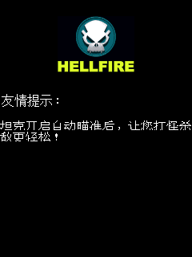 | Not assessed | Ready | The HELLFIRE splash and its 友情提示 render and later input dismisses the text, but only the logo and a black background remain at 2,500 frames; no crash is observed (issue #119) |
| 51 | `A/战火军旗V10.CBE` | 240×320 | 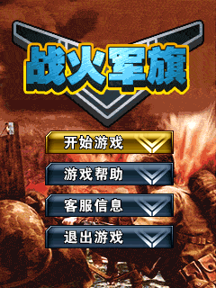 | Not assessed | Ready | Idle frame captured; interaction/gameplay unverified |
| 52 | `A/战火军棋(新品).CBE` | 240×320 | 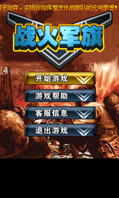 | Not assessed | Ready | Title, menu, help, purchase panel and keypad/touch checked; paid battles unverified |
| 53 | `A/拆弹专家V101.CBE` | 240×320 | 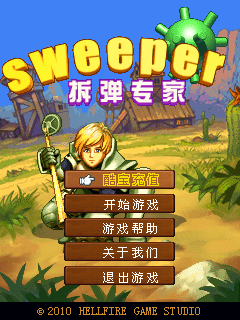 | Blocked: dead server | Ready | Online title: the guest requests the retired Coolbar platform service (vmt.51coolbar.com) and the offline error page is the firmware-faithful result; emulator-side fix is not possible (see issue #120) |
| 54 | `A/掌上书城V10.CBE` | 240×320 |  | Not assessed | Ready | Idle frame captured; interaction/gameplay unverified |
| 55 | `A/掌上地图V10.CBE` | 240×320 |  | Not assessed | Ready | Offline continuation frame captured; interaction/gameplay unverified |
| 56 | `A/星际宝藏(新品).CBE` | 240×320 |  | Not assessed | Ready | Normal mode reaches LEVEL1, but the play area is only a grey industrial backdrop with no gems or interactive objects; the tutorial text and part of the HUD do update (issue #121) |
| 57 | `A/星际宝藏V10.CBE` | 240×320 | 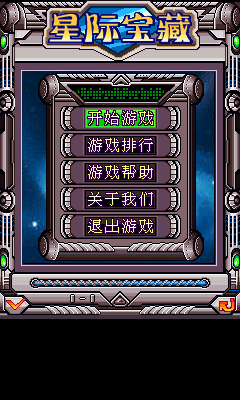 | Not assessed | Ready | Level-initialisation null indirect call fixed by f7ba663: Ready with 76,772 px / 75 colours where it used to fault; gameplay beyond the fixed path is unverified (issue #122) |
| 58 | `A/暴力摩托(新品).CBE` | 240×320 | 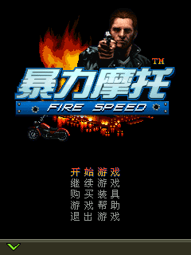 | Not assessed | Ready | Scene reached after the repair (76800 px / 211 colors) and the run halts at `EXIT_ADDRESS` as it did before it; the previous null request during boot is gone; controls unverified
| 59 | `A/暴力摩托V10.CBE` | 240×320 | 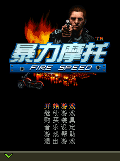 | Not assessed | Ready | Scene reached after the repair (76800 px / 209 colors) and the run halts at `EXIT_ADDRESS` as it did before it; the previous null request during boot is gone; controls unverified
| 60 | `A/极品飞车(火爆).CBE` | 240×320 | 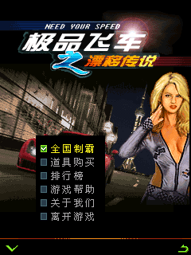 | Not assessed | Ready | Startup, menu navigation, help, back and touch input verified; starting a race still hits a guest picture-library assertion |
| 61 | `A/极品飞车V10.CBE` | 240×320 | 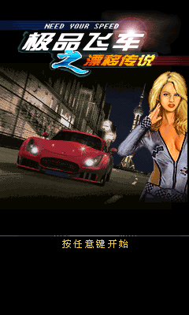 | Not assessed | Ready | Idle frame captured; interaction/gameplay unverified |
| 62 | `A/极限挑战V101.CBE` | 240×320 |  | Blocked: dead server | Ready | Online title: the guest requests the retired Coolbar platform service (vmt.51coolbar.com) and the offline error page is the firmware-faithful result; emulator-side fix is not possible (see issue #125) |
| 63 | `A/毒蛇行动V101.CBE` | 240×320 | 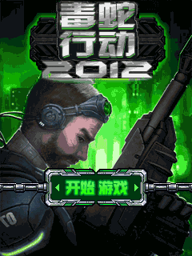 | Offline menu; paid play unverified | Ready | Title/menu, character-selection screen, return navigation and fee prompt checked; paid gameplay remains unverified |
| 64 | `A/江湖Online(大型网游)V10.CBE` | 240×320 | 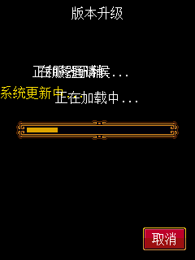 | Blocked: dead server | Ready | Online title: the guest requests the retired Coolbar platform service (dl.kvbar.com) and the offline error page is the firmware-faithful result; emulator-side fix is not possible (see issue #126) |
| 65 | `A/法老祖玛(新品).CBE` | 240×320 | 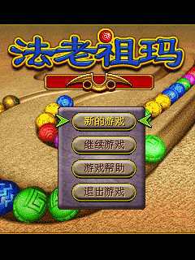 | Not assessed | Ready | Playable at the default 100M instructions/frame budget: level select enters the Zuma track (355-point HUD), confirm-key shots insert balls into the chain, and the pause/return menu responds (#127 closed; its 20M per-frame budget was too tight for the loading frame) |
| 66 | `A/法老祖玛V10.CBE` | 240×320 |  | Not assessed | Ready | Idle frame captured; interaction/gameplay unverified |
| 67 | `A/漂亮小护士(新品).CBE` | 240×320 |  | Not assessed | Ready | Playable at the default 100M instructions/frame budget: selected continuation enters the ward grid (time 44 countdown, remaining 10), pointer taps drive tile elimination down to remaining 5, and the pause menu responds (#128 closed; its 20M per-frame budget was too tight for the loading frame) |
| 68 | `A/漂亮小护士V10.CBE` | 240×320 | 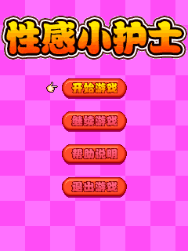 | Not assessed | Ready | Idle frame captured; interaction/gameplay unverified |
| 69 | `A/漫画大王(新品).CBE` | 240×320 |  | Not assessed | Ready | Title text renders; comic content and basic functionality unverified |
| 70 | `A/炸弹人(新品).CBE` | 240×320 |  | Not assessed | Ready | Playable: 150-frame confirm-key run reaches the stage (76800 px / 365 colors) and returns through `EXIT_ADDRESS`; the payload-valued method slot is treated as an unimplemented call; later stages unverified
| 71 | `A/热辣美图(新品).CBE` | 240×320 |  | Not assessed | Ready | Title, complete usage prompt and picture-browser navigation verified for 2,000 frames; remote downloads unverified |
| 72 | `A/爱之征途V101.CBE` | 240×320 | 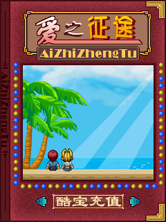 | Blocked: dead server | Ready | Online title: the guest requests the retired Coolbar platform service (vmt.51coolbar.com) and the offline error page is the firmware-faithful result; emulator-side fix is not possible (see issue #130) |
| 73 | `A/王牌伞兵(新品).CBE` | 240×320 | 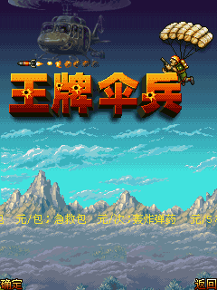 | Not assessed | Ready | Playable: 150-frame confirm-key run finishes Ready (74587 px / 163 colors) and returns through `EXIT_ADDRESS`; the Loading null method call is repaired; later stages unverified
| 74 | `A/王牌伞兵V10.CBE` | 240×320 | 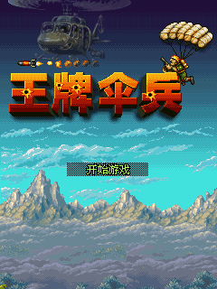 | Not assessed | Ready | Playable: 150-frame confirm-key run finishes Ready (74535 px / 127 colors) and returns through `EXIT_ADDRESS`; the Loading null method call is repaired; later stages unverified
| 75 | `A/生化危机(新品).CBE` | 320×240 |  | Not assessed | Ready | NIGHT1 background, toolbar and ammo counter render and firing consumes ammo (90→80→60), but no enemy, placement or recognisable attack effect appears by 2,200 frames (issue #133) |
| 76 | `A/生化危机V10.CBE` | 320×240 |  | Not assessed | Ready | NIGHT1 background and toolbar render and input changes the ammo counter, but no enemy, placement or attack effect appears by 2,200 frames (issue #134) |
| 77 | `A/生化危机V101.CBE` | 320×240 | 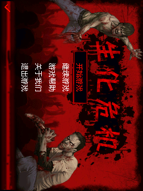 | Not assessed | Ready | The introduction reaches NIGHT1 and menus, weapon selection and the ammo count respond, but only background and toolbar remain at 2,300 frames (issue #135) |
| 78 | `A/生肖宝贝(新品).CBE` | 240×320 | 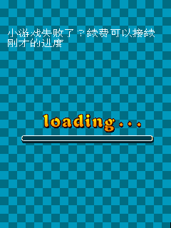 | Not assessed | Ready | Startup stays on a blue tiled loading screen with a moving progress bar and the challenge-failed / renewal text is overlaid on that same loading art before any playable screen appears (issue #136) |
| 79 | `A/生肖运程V10.CBE` | 240×320 |  | Not assessed | Ready | Image palette colors checked; interaction/gameplay unverified |
| 80 | `A/疯狂斗地主(新品).CBE` | 240×320 | 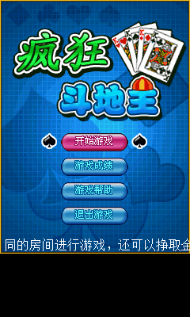 | Not assessed | Ready | Menu, help, card actions and one round result checked; a resumed deal then ends with no hand, kitty, timer or score at 2,200 frames, and the exit/re-entry path shows a loading caption with three missing-glyph buttons (issue #137) |
| 81 | `A/疯狂斗地主V10.CBE` | 240×320 | 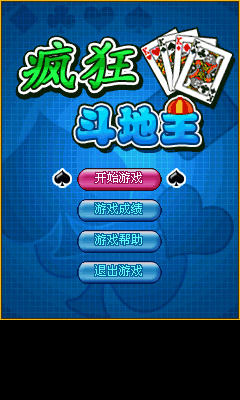 | Not assessed | Ready | Billing return, character select and a real deal work — cards can be played and the opponent responds — but by 2,200 frames only the characters and empty frames remain, with no hand, kitty, timer, score or settlement prompt (issue #138) |
| 82 | `A/移动书城V10.CBE` | 240×320 | 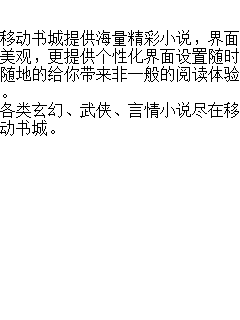 | Not assessed | Ready | Offline continuation frame captured; interaction/gameplay unverified |
| 83 | `A/穿越火线V101.CBE` | 240×320 |  | Not assessed | Ready | Offline continuation frame captured; interaction/gameplay unverified |
| 84 | `A/绝密宝藏(新品).CBE` | 240×320 | 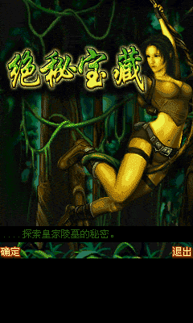 | Not assessed | Ready | The reported invalid-address jump no longer reproduces: Ready with 76,741 non-empty pixels on both the pre-fix and post-fix builds; full exploration is unverified (issue #139) |
| 85 | `A/绝秘宝藏V10.CBE` | 240×320 | 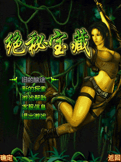 | Not assessed | Ready | The reported invalid ARM instruction no longer reproduces: Ready with 76,741 non-empty pixels on both the pre-fix and post-fix builds; full exploration is unverified (issue #140) |
| 86 | `A/绝秘宝藏V101.CBE` | 240×320 |  | Not assessed | Ready | Offline continuation frame captured; interaction/gameplay unverified |
| 87 | `A/美女俄罗斯V10.CBE` | 240×320 |  | Not assessed | Ready | Offline continuation frame captured; interaction/gameplay unverified |
| 88 | `A/美女拖拉机V10.CBE` | 240×320 |  | Not assessed | Ready | Title, menus and scene navigation verified for 2,000 frames; complete gameplay unverified |
| 89 | `A/联网五子棋(新版)V101.CBE` | 240×320 |  | Blocked: dead server | Ready | Login screen renders and responds to taps, soft keys and arrows; 快速登陆 opens the retired lobby channel `ghlc.51coolbar.com:20050`, so rooms and play are unobtainable |
| 90 | `A/联网扎金花(新版)V101.CBE` | 240×320 |  | Blocked: dead server | Ready | Login screen renders and responds to taps, soft keys and arrows; 快速登陆 opens the retired lobby channel `ghlc.51coolbar.com:20050`, so rooms and play are unobtainable |
| 91 | `A/联网拖拉机(新版)V101.CBE` | 240×320 |  | Blocked: dead server | Ready | Login screen renders and responds to taps, soft keys and arrows; 快速登陆 opens the retired lobby channel `ghlc.51coolbar.com:20050`, so rooms and play are unobtainable |
| 92 | `A/联网斗地主(新版)V101.CBE` | 240×320 |  | Blocked: dead server | Ready | Login screen renders and responds to taps, soft keys and arrows; 快速登陆 opens the retired lobby channel `ghlc.51coolbar.com:20050`, so rooms and play are unobtainable |
| 93 | `A/联网泡泡龙(新版)V101.CBE` | 240×320 |  | Blocked: dead server | Ready | Login screen renders and responds to taps, soft keys and arrows; 快速登陆 opens the retired lobby channel `ghlc.51coolbar.com:20050`, so rooms and play are unobtainable |
| 94 | `A/联网麻将(强推)V101.CBE` | 240×320 |  | Blocked: dead server | Ready | Login screen renders and responds to taps, soft keys and arrows; 快速登陆 opens the retired lobby channel `ghlc.51coolbar.com:20050`, so rooms and play are unobtainable |
| 95 | `A/象棋之唐伯虎点秋香V10.CBE` | 240×320 |  | Not assessed | Ready | Loading reaches 100% without a board; later input prints 棋局开始 over the stale loading bar and background, so no recognisable Xiangqi move is possible (issue #148) |
| 96 | `A/贪吃鱼(经典).CBE` | 240×320 |  | Not assessed | Ready | Title/menu, help text and basic selection checked; complete gameplay unverified |
| 97 | `A/超级八十分(新品).CBE` | 240×320 |  | Not assessed | Ready | Character profiles display and switch (portraits are grey), but Confirm, 5, the left soft key and a double tap on 确定 never leave character select and no deal appears by 1,500 frames (issue #150) |
| 98 | `A/超级泡泡龙(新品).CBE` | 240×320 |  | Touch / keys | Ready | Title/menu, help/back, level selection and game board verified through 2,000 frames; dismiss the startup offer before navigating. Firing effects, full gameplay and paid progression unverified |
| 99 | `A/超级泡泡龙V10.CBE` | 240×320 |  | Touch / keys | Ready | Title/menu, help/back, game board and numeric-5 firing with bubble removal/score increase verified; repeated input through 2,000 frames remains Ready. Full gameplay and paid progression unverified |
| 100 | `A/超级玛丽(新品).CBE` | 240×320 |  | Not assessed | Ready | Level entry completes Ready after the repair (76800 px, 6 colors); the shared f7ba663 repair removed the actor initialization null call, but the frame carries little content, so rendered play unverified
| 101 | `A/超级玛丽V10.CBE` | 240×320 |  | Not assessed | Ready | World 1-1 shows ground, clouds, HUD and the on-screen D-pad but the player is invisible; numeric direction/jump, arrow keys, Confirm and D-pad taps produce no recognisable movement or jump by 1,000 frames (issue #152) |
| 102 | `A/超级麻将(新品).CBE` | 240×320 |  | Not assessed | Ready | Title/menu rendering and basic selection checked for 2,000 frames; complete gameplay unverified |
| 103 | `A/超级麻将V10.CBE` | 240×320 |  | Not assessed | Ready | Title/menu and room selection verified for 2,000 frames; full rounds and online rooms unverified |
| 104 | `A/酷宝充值(短信直充)V101.CBE` | 240×320 |  | Required | Ready | Account/password form, numeric editing and password masking checked; online login and actual recharge unavailable |
| 105 | `A/金刚大战V10.CBE` | 240×320 |  | Not assessed | Ready | Robot/hauler, ore and scenery render and input switches the robot into the hauler, but several dialogue lines stack in one box and the money/time/score HUD carries no values (issue #153) |
| 106 | `A/金字塔传奇(新品).CBE` | 240×320 |  | Not assessed | Ready | Title/menu rendering and basic selection checked for 2,000 frames; complete gameplay unverified |
| 107 | `A/金字塔传奇V101.CBE` | 240×320 |  | Not assessed | Ready | Offline continuation frame captured; interaction/gameplay unverified |
| 108 | `A/陆小凤传奇V101.CBE` | 240×320 |  | Offline opening checked | Ready | Local billing enters combat; directional movement, attacks and shop navigation verified through 3,000 frames. Shop digits respect their LCD clip. Full campaign and purchases unverified |
| 109 | `A/雷霆战机(新品).CBE` | 240×320 |  | Not assessed | Ready | Loading prompt and ranking panel render; after aircraft selection the guest fetches from 0xB2C8ABA0 (resource data used as a method pointer), so normal startup never completes (issue #154) |
| 110 | `A/雷霆战机V10.CBE` | 240×320 |  | Not assessed | Ready | Scene-load null call fixed by f7ba663: Ready with 26,122 px / 113 colours where it used to fault; playable stages are unverified (issue #155) |
| 111 | `A/马戏团(新品).CBE` | 240×320 |  | Not assessed | Ready | Levels are playable — movement, jumping and score 100→1300→3400 — but the help pop-up text crosses the purple panel on both sides and is clipped at the screen edges; Ready at 2,200 frames (issue #156) |
| 112 | `A/马戏团V10.CBE` | 240×320 |  | Not assessed | Ready | Idle frame captured; interaction/gameplay unverified |
| 113 | `A/马戏团V101.CBE` | 240×320 |  | Blocked: dead server | Ready | Online title: the guest requests the retired Coolbar platform service (vmt.51coolbar.com) and the offline error page is the firmware-faithful result; emulator-side fix is not possible (see issue #157) |
| 114 | `A/魔兽塔防(新品).CBE` | 240×320 |  | Not assessed | Ready | Service 72 native tile-map fix (9c021ca): full TD map (path, buildable area, spawn points) renders, build menu with tower stats (攻击5 射程30 间隔15 范围2) renders, starting gold 40 correct, UI responds to input. |
| 115 | `A/魔兽塔防V10.CBE` | 240×320 |  | Not assessed | Ready | Title/menu, help and return verified for 2,000 frames; service 72 native tile-map fix (9c021ca): blank map resolved — TD map renders with two enemies walking the path, gold/lives HUD correct, 跳过 button interactive, build menu with tower stats reachable. |
| 116 | `A/魔力弹球(新品).CBE` | 240×320 |  | Not assessed | Ready | Title/menu rendering and basic selection checked for 2,000 frames; complete gameplay unverified |
| 117 | `A/魔塔(新品).CBE` | 240×320 |  | Not assessed | Ready | Start/trial confirmation, first-floor map, stairs, NPC and touch movement verified; 2,000-frame repeated-tap check; brief black frames during first-floor entry remain and later floors/combat are unverified (issue #160) |
| 118 | `A/魔塔V10.CBE` | 240×320 |  | Not assessed | Ready | First-floor map, stairs, NPC and touch movement; 2,000-frame repeated-tap check; later floors/combat unverified |
| 119 | `A/魔幻英雄(新品).CBE` | 240×320 |  | Not assessed | Ready | Playable: 150-frame confirm-key run reaches gameplay (76541 px / 80 colors) and returns cleanly through `EXIT_ADDRESS`; slots that name no routine are treated as unimplemented calls; complete gameplay unverified
| 120 | `A/魔幻英雄(新品)V10.CBE` | 240×320 |  | Not assessed | Ready | Offline continuation frame captured; interaction/gameplay unverified |
| 121 | `A/魔幻英雄V101.CBE` | 240×320 |  | Blocked: dead server | Ready | Online title: the guest requests the retired Coolbar platform service (vmt.51coolbar.com) and the offline error page is the firmware-faithful result; emulator-side fix is not possible (see issue #163) |
| 122 | `A/鹿鼎记(新品推荐)V10.CBE` | 240×320 |  | Not assessed | Ready | The startup decode is a legitimate one-shot of about 39.5M instructions, after which the run settles to 7,487 per frame and reaches 76,350 px / 151 colours; a second Confirm at frame 50 then runs away (>100M in one frame) inside a memset loop whose end pointer walks past the 4 MiB heap pool (issue #164) |
| 123 | `A/龙王战士V101.CBE` | 240×320 |  | Blocked: dead server | Ready | Online title: the guest requests the retired Coolbar platform service (vmt.51coolbar.com) and the offline error page is the firmware-faithful result; emulator-side fix is not possible (see issue #165) |

### Group B

| # | Application / file | Display | Screenshot | Network | Execution | Coverage / limitation |
| ---: | --- | --- | --- | --- | --- | --- |
| 1 | `B/AppStore.CBE` | 240×400 |  | Required | Ready | Idle frame captured; interaction/gameplay unverified |
| 2 | `B/Google地图.CBE` | 240×400 |  | Required | Ready | Packaged background renders; firmware-provided terms/title text unavailable; online operation unverified |
| 3 | `B/万年历.CBE` | 240×400 |  | No known requirement | Ready | Idle frame captured; interaction/gameplay unverified |
| 4 | `B/三国群殴传.CBE` | 400×240 |  | No known requirement | Ready | Title and the world map render, but the level briefing area is empty with five grey character icons; a 130-frame replay takes about 63 s and the 300-frame sequence is cut off by the 90 s guard, so unit placement and combat stay unverified (issue #166) |
| 5 | `B/世纪佳缘.CBE` | 240×400 |  | Required | Ready | Idle frame captured; interaction/gameplay unverified |
| 6 | `B/众神之战.CBE` | 240×400 |  | No known requirement | Ready | Idle frame captured; interaction/gameplay unverified |
| 7 | `B/僵尸先生.CBE` | 400×240 |  | No known requirement | Ready | Installation completes and the title renders, and the idle 200-frame capture stays Ready; under the issue's input sequence the run instead ends Halted with 95,760 px / 3 colours — the guest exits instead of continuing into gameplay (issue #167) |
| 8 | `B/割绳子.CBE` | 240×400 |  | No known requirement | Ready | Episode boxes respond and a yellow level-select screen opens, but its buttons only peek from the top edge and a translucent bar runs down the centre; taps and 5 never reveal the rope, the candy or a playable level (issue #168) |
| 9 | `B/割绳子冬季版.CBE` | 240×400 |  | No known requirement | Ready | The 150-frame replay already shows the same clipped level-select screen — buttons at the top edge, translucent centre bar — and taps and 5 never enter a rope-cutting level (issue #169) |
| 10 | `B/动感骰子.CBE` | 240×400 |  | No known requirement | Ready | The native exit dialog cancels and the gear opens settings with a dice preview, but returning still leaves an empty table and no dice or roll result by 580 frames (issue #170) |
| 11 | `B/吸血鬼猎人.CBE` | 400×240 |  | No known requirement | Ready | Battle loads with UI, background and turret and firing consumes ammo (00500→00477), but the lighting is hard-edged yellow rectangles and opaque black squares appear after shots (issue #171) |
| 12 | `B/在线书城.CBE` | 240×400 |  | Required | Halted | Offline failure prompt and normal timed exit verified; scrolling/font differences remain, online reading unverified |
| 13 | `B/在线音乐.CBE` | 240×400 |  | Required | Ready | Search controls, toolbars and add prompt render; prompt scrolls with current font metrics; online operation unverified |
| 14 | `B/士兵突袭.CBE` | 400×240 |  | No known requirement | Ready | Offscreen glyph-cache text restored; left/right movement, jumping/climbing and exit-dialog cancellation checked through 820 frames. Weapon switching, kills and full campaign unverified |
| 15 | `B/大家来数钱.CBE` | 240×400 |  | No known requirement | Ready | Transformed PNG transparency and restart random-number loop repaired; difficulty selection, bill dragging, restart and return to title checked through 542 frames. Full-round settlement and wealth accumulation unverified |
| 16 | `B/天气精灵.CBE` | 240×400 |  | Required | Ready | Idle frame captured; interaction/gameplay unverified |
| 17 | `B/孤岛.CBE` | 240×400 |  | No known requirement | Ready | Idle frame captured; interaction/gameplay unverified |
| 18 | `B/小酷.CBE` | 240×400 |  | No known requirement | Ready | Idle frame captured; interaction/gameplay unverified |
| 19 | `B/小鸟愤怒冬季版.CBE` | 400×240 |  | No known requirement | Ready | Title and SELECT EPISODE render, but both slots are a question mark plus gift box; taps, Confirm, 5 and the arrows leave it on the episode page at 700 frames (issue #172) |
| 20 | `B/幸运扑克机.CBE` | 400×240 |  | No known requirement | Ready | The bet screen responds (tutorial text, bet amounts, limits), but after dealing and closing the tutorial only hold markers remain — no recognisable card face (issue #173) |
| 21 | `B/开心大富翁.CBE` | 400×240 |  | No known requirement | Ready | Title and main menu work; single-player shows only two dark panels, a heart, colour bars and a selection box — no characters, names or confirm text — and input never reaches the board (issue #174) |
| 22 | `B/忍者跳跃.CBE` | 240×400 |  | No known requirement | Ready | Walls, blue background, the pause icon and the top counter render and the counter reaches 398, but the ninja and its obstacles never appear, so no climb, jump or attack is visible (issue #175) |
| 23 | `B/性爱宝典.CBE` | 240×400 |  | No known requirement | Ready | Disclaimer title, wrapped body and accept/reject labels render; interaction unverified |
| 24 | `B/性爱高手.CBE` | 240×400 |  | No known requirement | Ready | Idle frame captured; interaction/gameplay unverified |
| 25 | `B/恶魔城.CBE` | 240×400 |  | No known requirement | Ready | The main menu's second, fourth and fifth items all read 继续游戏; the fourth opens 关于我们 via three downs plus Confirm, so the visible labels do not match the actions. Levels still load, with left/right movement, camera scrolling and jump frames (issue #176) |
| 26 | `B/恶魔城登录版.CBE` | 240×320 |  | Required | Ready | Idle frame captured; interaction/gameplay unverified |
| 27 | `B/愤怒的小鸟.CBE` | 400×240 |  | No known requirement | Ready | PLAY opens SELECT EPISODE with a question-mark cake; taps on both, plus arrows and Confirm, never enter a slingshot level. A horizontal drag does flip the page dots to a second question-mark page (issue #177) |
| 28 | `B/战争机器.CBE` | 240×400 |  | No known requirement | Ready | Title, menus and several story segments render, but the formal input sequence stops on the HELLFIRE icon and auto-aim prompt and the guest halts around frame 156 (Ready at the 240-frame checkpoint, exit 0); no shooting scene is reachable (issue #178) |
| 29 | `B/打地鼠.CBE` | 240×400 |  | No known requirement | Ready | Help, mode select and the nine hole positions render and scoring works (3 points), but no mole is ever visible; at 500 frames the timer stays 00, the state becomes Halted and no result page appears (issue #179) |
| 30 | `B/打火机.CBE` | 240×400 |  | No known requirement | Ready | Idle frame captured; interaction/gameplay unverified |
| 31 | `B/捕鱼猎人.CBE` | 400×240 |  | No known requirement | Ready | Title, mode select and tutorial text render, but 达人 mode stays on LOADING at 260 and 900 frames and 挑战 mode at 600; a mixed-input path ends on a fully black frame at 1,000 frames (issue #180) |
| 32 | `B/新闻.CBE` | 240×400 |  | Required | Ready | Idle frame captured; interaction/gameplay unverified |
| 33 | `B/时间同步.CBE` | 240×400 |  | Required | Ready | Top icon/title missing; prompt renders |
| 34 | `B/暴力摩托.CBE` | 400×240 |  | No known requirement | Ready | Idle frame captured; interaction/gameplay unverified |
| 35 | `B/暴打小猪.CBE` | 240×400 |  | No known requirement | Ready | Idle frame captured; interaction/gameplay unverified |
| 36 | `B/机场指挥部.CBE` | 400×240 |  | No known requirement | Ready | Title, level select and the first level's high score render, but after 确定 the frame is fully black and the 700-frame replay with extra taps, Confirm and soft keys still shows no airport, runway or aircraft; the help page shows only the star backdrop and the pager (issue #181) |
| 37 | `B/极品飞车2012.CBE` | 240×400 |  | No known requirement | Ready | Idle frame captured; interaction/gameplay unverified |
| 38 | `B/果蔬连连看.CBE` | 240×400 |  | No known requirement | Ready | Idle frame captured; interaction/gameplay unverified |
| 39 | `B/枪之荣誉.CBE` | 240×400 |  | No known requirement | Ready | Idle frame captured; interaction/gameplay unverified |
| 40 | `B/武林外传(新品).CBE` | 240×320 |  | No known requirement | Ready | Compact alpha masks prevent first-battle heap exhaustion; left/right movement, heavy-hit input, score acknowledgement and return to battle checked through 1,016 frames. Full campaign, battle exit and audio unverified |
| 41 | `B/武林外传V10.CBE` | 240×320 |  | No known requirement | Ready | Image palette colors checked; interaction/gameplay unverified |
| 42 | `B/歪歪猫发条城历险记V100.CBE` | 176×220 |  | Required | Ready | Scalar rectangle outlines fix vertical streaks in the inventory; platform movement/scrolling, weapon firing (ammo 10→9), inventory selection and return to the stage checked. Full playthrough and audio unverified |
| 43 | `B/水果达人.CBE` | 400×240 |  | No known requirement | Ready | The arithmetic loop faults: a 110-frame replay exceeds the 20M instruction budget at 0x0101BB1C, so the classic mode and the later scene switch cannot be reached (issue #183). Needs a held drag, not repeated taps |
| 44 | `B/江湖Online.CBE` | 240×400 |  | Required | Ready | After installation the right soft key enters 获取版本信息 / 正在和服务器通讯请稍候 and it is still there at 2,701 frames; cancelling leaves only a green background (issue #184) |
| 45 | `B/法老祖玛2.CBE` | 400×240 |  | No known requirement | Ready | Menus reach 1-1 and a held drag moves the tray from x80 to x300 with 5 switching the shot colour, but the bead chain is uniformly dark grey and the pause menu is an empty red-brown frame (issue #185) |
| 46 | `B/涂鸦跳跃.CBE` | 240×352 |  | No known requirement | Ready | Idle frame captured; interaction/gameplay unverified |
| 47 | `B/消息盒子.CBE` | 240×400 |  | No known requirement | Ready | Idle frame captured; interaction/gameplay unverified |
| 48 | `B/激情砖块.CBE` | 240×400 |  | No known requirement | Ready | Touch Game → map → level 1 and dismiss the loading/story prompts; drag the paddle left/right. Ball motion, pause/continue, retry and return to map verified. Full levels, boss, shop and audio unverified |
| 49 | `B/火辣美女视频.CBE` | 240×400 |  | Required | Ready | Idle frame captured; interaction/gameplay unverified |
| 50 | `B/炫酷音乐彩铃.CBE` | 240×400 |  | Required | Ready | Idle frame captured; interaction/gameplay unverified |
| 51 | `B/热辣美图.CBE` | 240×400 |  | No known requirement | Ready | Idle frame captured; interaction/gameplay unverified |
| 52 | `B/牧场物语.CBE` | 240×400 |  | No known requirement | Ready | Confirm enters the story, another Confirm enters loading, and with input the guest halts by frame 72 while the screen stays a black loading page through frame 243 (the idle capture stays Ready); the map atlas index is not repaired (issue #186) |
| 53 | `B/猫和老鼠.CBE` | 240×400 |  | No known requirement | Ready | Idle frame captured; interaction/gameplay unverified |
| 54 | `B/现代情趣大全.CBE` | 240×400 |  | No known requirement | Ready | Idle frame captured; interaction/gameplay unverified |
| 55 | `B/电子邮件.CBE` | 240×400 |  | Required | Ready | Idle frame captured; interaction/gameplay unverified |
| 56 | `B/疯狂企鹅大冒险.CBE` | 400×240 |  | No known requirement | Ready | Tutorial, level select and level 1 run with movement, jumping and item count 5→4, but a solid black rectangle at about x184..215 / y106..159 persists behind the penguin (issue #187) |
| 57 | `B/疯狂捕鸟.CBE` | 400×240 |  | No known requirement | Ready | 达人 mode shows the canyon background and coin bar and input deducts coins (2000→1998), but no turret, projectile or bird is visible at 281 frames (issue #188) |
| 58 | `B/疯狂斗地主.CBE` | 400×240 |  | No known requirement | Ready | Idle frame captured; interaction/gameplay unverified |
| 59 | `B/皇牌空战.CBE` | 240×400 |  | No known requirement | Ready | Idle frame captured; interaction/gameplay unverified |
| 60 | `B/碰嘭球.CBE` | 240×400 |  | No known requirement | Ready | The bubble board, launcher and menu render and firing changes the board, but returning to level select, re-entering level 1 and firing makes the guest fetch from an invalid address; the board freezes at the last shot (issue #189) |
| 61 | `B/移淘网.CBE` | 240×400 |  | Required | Ready | Idle frame captured; interaction/gameplay unverified |
| 62 | `B/笑死人.CBE` | 240×400 |  | No known requirement | Ready | Idle frame captured; interaction/gameplay unverified |
| 63 | `B/美女桌球.CBE` | 400×240 |  | No known requirement | Ready | Title, character/level select, the LEVEL 1 tutorial, the ball rack and the power/shot bar all render (70827 px / 1483 colours) and the run now finishes cleanly. Entering the first level used to hang: the guest's software float helpers open with ARMv5 `CLZ`, which the ARMv4T core decoded as a data-processing op that never wrote its destination, so the ball's step size collapsed to zero and the per-pixel draw loop never ended (issue #190). Character select content and the playable table are still unverified. |
| 64 | `B/英汉词典.CBE` | 240×400 |  | No known requirement | Ready | Idle frame captured; interaction/gameplay unverified |
| 65 | `B/血剑Online.CBE` | 240×400 |  | Required | Ready | Confirm opens a normal login page, but tapping the account field (127,146), 确认 (12,387), 返回 (228,387), Confirm, soft keys, arrows and digits never show an editor or any visible result; still the empty login page at 448 frames (issue #191) |
| 66 | `B/钻石迷情3.CBE` | 240×400 |  | No known requirement | Ready | Idle frame captured; classic mode verified: first entry matches and swap touches score 0→50, and returning to the title and re-entering three times no longer blacks out — the re-entry decodes used to fail because the image-release slot leaked every decoded picture's pixel allocation until the heap pool ran out (fixed in b75283f). See issue #192 |
| 67 | `B/雄霸天下.CBE` | 240×400 |  | Required | Ready | Any key enters the online flow, which reports 与服务器中断，重新登陆！ / 网络连接中，请稍后 and never shows characters, a map or gameplay; every input leaves it on that prompt (issue #193) |
| 68 | `B/雷电.CBE` | 240×400 |  | No known requirement | Ready | Idle frame captured; interaction/gameplay unverified |
| 69 | `B/雷霆战机.CBE` | 240×400 |  | No known requirement | Ready | Idle frame captured; interaction/gameplay unverified |
| 70 | `B/马戏团.CBE` | 240×400 |  | No known requirement | Ready | Idle frame captured; interaction/gameplay unverified |
| 71 | `B/鬼吹灯.CBE` | 240×400 |  | No known requirement | Ready | New game → introduction → first level renders the map, characters and opening dialogue, and 6 moves the character and scrolls the scene; after the in-game 5 (reset room) the character disappears and never returns (issue #194) |
| 72 | `B/魔兽塔防.CBE` | 240×400 |  | No known requirement | Ready | Idle frame captured; interaction/gameplay unverified |
| 73 | `B/魔塔.CBE` | 240×400 |  | No known requirement | Ready | Idle frame captured; interaction/gameplay unverified |
| 74 | `B/魔鬼理发师.CBE` | 240×400 |  | No known requirement | Ready | Idle frame captured; interaction/gameplay unverified |

### Group C

| # | Application / file | Display | Screenshot | Network | Execution | Coverage / limitation |
| ---: | --- | --- | --- | --- | --- | --- |
| 1 | `C/Almanac.CBE` | 176×220 |  | Not assessed | Ready | Offline error panel renders; interaction and online content unverified |
| 2 | `C/Apotheosize.CBE` | 176×220 |  | Not assessed | Ready | Little-endian string lengths restore new-game XSE loading; opening dialogue, palace movement, menus and save confirmation checked; combat, later maps and full campaign unverified |
| 3 | `C/BombMan.CBE` | 176×220 |  | Not assessed | Ready | Native 176×220 LCD; startup margins resolved; gameplay unverified |
| 4 | `C/Bowling.CBE` | 176×220 |  | Not assessed | Ready | Native 176×220 LCD; startup margins resolved; gameplay unverified |
| 5 | `C/brick.CBE` | 176×220 |  | Not assessed | Ready | Local billing grants coins and level 1 loads with a movable paddle, but one serve order stalls the ball: plate Confirm at start, immediately Confirm to serve, then move and press 5 — still 5 lives, 0 points and untouched bricks at 340 frames (issue #195) |
| 6 | `C/Car.CBE` | 176×220 |  | Not assessed | Ready | Little-endian stream writes restore the initial nitro count to 3; track/car selection, race start, acceleration, steering, nitro use and menu navigation checked; complete race, campaign and audio unverified |
| 7 | `C/Cartoon.CBE` | 176×220 |  | Not assessed | Ready | Idle frame captured; interaction/gameplay unverified |
| 8 | `C/DaimonCastle.CBE` | 176×220 |  | Not assessed | Ready | Native 176×220 LCD; startup margins resolved; gameplay unverified |
| 9 | `C/Deluxe.CBE` | 176×220 |  | Not assessed | Ready | Native 176×220 LCD; startup margins resolved; gameplay unverified |
| 10 | `C/dragon.CBE` | 176×220 |  | Not assessed | Ready | Native 176×220 LCD; startup margins resolved, but the play run is a ROM defect — not repairable host-side: the game's image library leaves slot 18 (`images[17] = 0x0000D4FF`) uninitialised, so the width read after the load is 0 and the next division faults. See issue #197, closed as won't-fix. |
| 11 | `C/Ebook.CBE` | 176×220 |  | Not assessed | Ready | Bookshelf/directional selection checked; native 176x220 viewport missing; remote books unavailable |
| 12 | `C/Eden.CBE` | 176×220 |  | Not assessed | Ready | Idle frame captured; interaction/gameplay unverified |
| 13 | `C/Email.CBE` | 176×220 |  | Not assessed | Ready | Idle frame captured; interaction/gameplay unverified |
| 14 | `C/Fighter.CBE` | 176×220 |  | Not assessed | Ready | Native 176×220 LCD; startup margins resolved; gameplay unverified |
| 15 | `C/Garden.CBE` | 176×220 |  | Not assessed | Ready | Native 176×220 LCD; startup margins resolved; gameplay unverified |
| 16 | `C/GoldMan.CBE` | 176×220 |  | Not assessed | Ready | Native 176×220 LCD; startup margins resolved; gameplay unverified |
| 17 | `C/happySheep.CBE` | 176×220 |  | Not assessed | Ready | Native 176×220 LCD; startup margins resolved; gameplay unverified |
| 18 | `C/HellRaider.CBE` | 176×220 |  | Not assessed | Ready | Native 176×220 LCD; startup margins resolved; gameplay unverified |
| 19 | `C/HitLand.CBE` | 176×220 |  | Not assessed | Ready | Native 176×220 LCD; startup margins resolved; gameplay unverified |
| 20 | `C/Im.CBE` | 176×220 |  | Required for online login | Ready | Login screen and field-focus navigation checked for 2,000 frames; online authentication unavailable |
| 21 | `C/kriegspiel.CBE` | 176×220 |  | Not assessed | Ready | Native 176×220 LCD; startup margins resolved; gameplay unverified |
| 22 | `C/MaJiang.CBE` | 176×220 |  | Not assessed | Ready | Idle frame captured; interaction/gameplay unverified |
| 23 | `C/Map.CBE` | 176×220 |  | Not assessed | Ready | Map grid, center marker and bottom menu render; online map data unverified |
| 24 | `C/mario.CBE` | 176×220 |  | Not assessed | Ready | World 1-1 shows the player bottom-left with ground, clouds and HUD, but holding 6 for a single outer frame at 82–83 makes the player invisible for the rest of the run; 5 lives, 0 coins, Ready (issue #198) |
| 25 | `C/MetalSlug.CBE` | 176×220 |  | Not assessed | Ready | Native 176×220 LCD; tutorial text uses the supplied RGB565 color. First-stage movement, jumping, firing and menus checked; complete stages and audio unverified. |
| 26 | `C/MoTa.CBE` | 176×220 |  | Not assessed | Ready | Native 176×220 LCD; startup margins resolved; gameplay unverified |
| 27 | `C/MyGirl.CBE` | 176×220 |  | Not assessed | Ready | Native 176×220 LCD; startup margins resolved; gameplay unverified |
| 28 | `C/netgobang.CBE` | 176×220 |  | Not assessed | Ready | Confirm reports an empty username/password; after dismissing it, tapping the fields and typing 1/2/3 shows a cursor but the fields stay empty, and 登录 / 快速注册 never reach a room or a board (issue #199) |
| 29 | `C/netGoldFlower.CBE` | 176×220 |  | Not assessed | Ready | The same empty-credential loop: the fields take focus and show a cursor but no digits, and 登录 / 快速注册 / the soft keys leave the empty login page at 304 frames (issue #200) |
| 30 | `C/Picview.CBE` | 176×220 |  | Not assessed | Ready | Idle frame captured; interaction/gameplay unverified |
| 31 | `C/Pocker.CBE` | 176×220 |  | Not assessed | Ready | Idle frame captured; interaction/gameplay unverified |
| 32 | `C/Precious.CBE` | 176×220 |  | Not assessed | Ready | Native 176×220 LCD; startup margins resolved; gameplay unverified |
| 33 | `C/Rich.CBE` | 176×220 |  | Not assessed | Ready | Native 176×220 LCD; startup margins resolved; gameplay run is a ROM defect — not repairable host-side: the game's resource handler (load callback 0x01009266) is non-idempotent, gets invoked twice without re-seeding its group-index table (game-side pump call, then the standard screen lifecycle), and the stale write-back indices 48/51/54 read the name pool past the stack top into unmapped memory, so the map load returns resource id 0xFFFFFFFF and the width-0 image divides by zero. See issue #201 |
| 34 | `C/Ringside.CBE` | 176×220 |  | Not assessed | Ready | Native 176×220 LCD; startup margins resolved; gameplay unverified |
| 35 | `C/RussBlock.CBE` | 176×220 |  | Not assessed | Ready | Native 176×220 LCD; startup margins resolved; gameplay unverified |
| 36 | `C/Sanbing.CBE` | 176×220 |  | Not assessed | Ready | Native 176×220 LCD; startup margins resolved; gameplay unverified |
| 37 | `C/Star.CBE` | 176×220 |  | Not assessed | Ready | Native 176×220 LCD; startup margins resolved; gameplay unverified |
| 38 | `C/Stock.CBE` | 176×220 |  | Not assessed | Ready | Native 176×220 LCD; packed coordinates corrected; menu no longer clipped; gameplay unverified |
| 39 | `C/SuperAirship.CBE` | 176×220 |  | Not assessed | Ready | Native 176×220 LCD; startup margins resolved; gameplay unverified |
| 40 | `C/Sxbaby.CBE` | 176×220 |  | Not assessed | Ready | Native 176×220 LCD; startup margins resolved; gameplay unverified |
| 41 | `C/TankWar.CBE` | 176×220 |  | Not assessed | Ready | Native 176×220 LCD; startup margins resolved; gameplay unverified |
| 42 | `C/TD.CBE` | 176×220 |  | Not assessed | Ready | Native 176×220 LCD; startup margins resolved; gameplay unverified |
| 43 | `C/TF.CBE` | 176×220 |  | Not assessed | Ready | Native 176×220 LCD; startup margins resolved; gameplay unverified |
| 44 | `C/Train.CBE` | 176×220 |  | Not assessed | Ready | Native 176×220 LCD; packed coordinates corrected; menu no longer clipped; gameplay unverified |
| 45 | `C/UniversalWar.CBE` | 176×220 |  | Not assessed | Ready | Native 176×220 LCD; startup margins resolved; gameplay unverified |
| 46 | `C/Weather.CBE` | 176×220 |  | Not assessed | Ready | Idle frame captured; interaction/gameplay unverified |
| 47 | `C/Zombie.CBE` | 220×176 |  | Not assessed | Ready | Automatic landscape 220×176; LCD margins resolved; gameplay unverified |
| 48 | `C/ZuMa.CBE` | 176×220 |  | Not assessed | Ready | Native 176×220 LCD; packed coordinates corrected; menu no longer clipped; gameplay unverified |

## Known Limitations

- Shared startup templates still reach guest assertions and halt with black frames.
- Native Scene/Actor, Listener/Talker and control interfaces are incomplete;
  a successful idle run does not certify paths entered by subsequent input.
- Network services use offline responses. Remote content, original online sessions
  and carrier billing are unavailable. Guest file writes are not persisted to host
  storage; host sidecar files are loaded read-only.
- Westward Journey's later animation/content and the specific rendering gaps
  listed in the tables remain incomplete. QCIF LCD sizes are resolved, but font
  images/UI content in netgobang and netGoldFlower remain incorrect.
- Complete playthroughs, every character/stage, all audio paths and all resolutions
  have not been validated. File-based MP3 control is incomplete.
- Save states restore guest memory and execution, but host-side virtual files,
  pending network/billing callbacks and the random generator state are not
  serialized. Resuming across these operations is not fully supported.

## Reporting a Compatibility Issue

Include the group, filename, resolution, last visible screen, triggering input
and error text. Reproduce with `cbe_boot` and scripted phone keys where possible.
Do not attach copyrighted game packages to public reports.

```bash
cargo run --release -p coolbaremu-tools --bin cbe_boot -- \
  path/to/game.CBE --frames 200 --key-event 1:14 --screenshot frame.png
```

Use `CBE_TRACE=all` or selected services such as `CBE_TRACE=4:24,6:3` for diagnostics.
